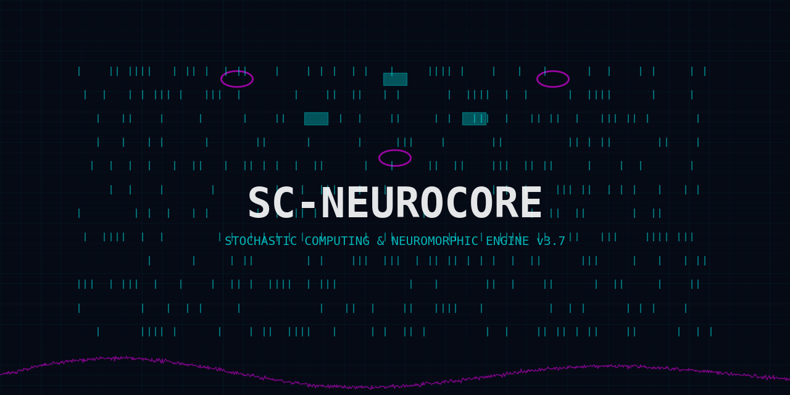
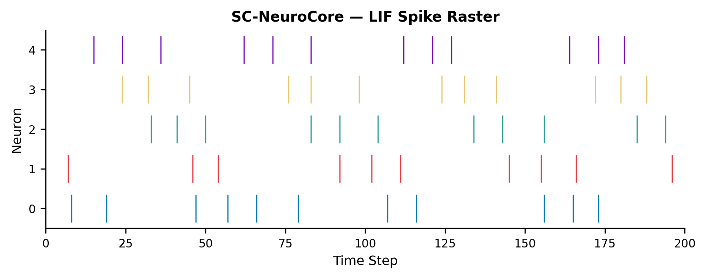
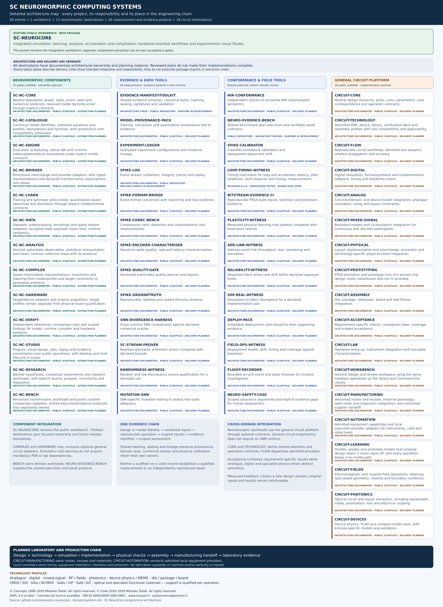

<!-- SPDX-License-Identifier: AGPL-3.0-or-later -->
<!-- Commercial license available -->
<!-- © Concepts 1996–2026 Miroslav Šotek. All rights reserved. -->
<!-- © Code 2020–2026 Miroslav Šotek. All rights reserved. -->
<!-- ORCID: 0009-0009-3560-0851 -->
<!-- Contact: www.anulum.li | protoscience@anulum.li -->
<!-- SC-NeuroCore — Universal stochastic computing framework -->

# SC-NeuroCore

> This repository is a public mirror of ANULUM's canonical source; development history predating publication is held privately.

<p align="center">
  
</p>

[](https://github.com/anulum/sc-neurocore/actions/workflows/ci.yml)
[](https://codecov.io/gh/anulum/sc-neurocore)
[](https://github.com/anulum/sc-neurocore/actions/workflows/codeql.yml)
[](https://pypi.org/project/sc-neurocore/)
[](https://pypi.org/project/sc-neurocore/)
[](https://pepy.tech/project/sc-neurocore)
[](https://mypy-lang.org/)
[](https://github.com/astral-sh/ruff)
[](https://peps.python.org/pep-0561/)
[](https://github.com/pre-commit/pre-commit)
[](https://anulum.github.io/sc-neurocore/)
[](https://github.com/sponsors/anulum)
[](https://www.gnu.org/licenses/agpl-3.0)
[](https://www.python.org/downloads/)
[](https://www.rust-lang.org/)
[](https://www.bestpractices.dev/projects/12175)
[](https://scorecard.dev/viewer/?uri=github.com/anulum/sc-neurocore)
[](https://api.reuse.software/info/github.com/anulum/sc-neurocore)
[](https://colab.research.google.com/github/anulum/sc-neurocore/blob/main/notebooks/quickstart_colab.ipynb)

**Stochastic computing and neuromorphic hardware co-design toolkit**

**Version:** 4.2.0

SC-NeuroCore is a research-to-hardware software stack for designing spiking and stochastic neural systems, validating their numerical behaviour, and moving selected models toward FPGA, ASIC, and embedded neuromorphic deployment. It combines a Python public API, an optional Rust acceleration engine, SystemVerilog generation paths, benchmark evidence, and polyglot research mirrors for selected kernels.

It is useful when a team needs to answer practical questions such as:

- Can a stochastic bitstream representation approximate this neural computation within a bounded error budget?
- Which neuron, synapse, encoder, or network path is numerically appropriate for a target workload?
- Can a model be converted into auditable hardware artefacts rather than remaining only a Python simulation?
- Which evidence is available for speed, parity, synthesis, safety-case readiness, or cross-framework comparison?
- Which capabilities are stable package surfaces and which remain source-checkout research surfaces?

<p align="center">
  
</p>

## Quick Start

```bash
pip install sc-neurocore
sc-neurocore info
sc-neurocore --help
```

The CLI groups model, hardware, Studio, data, training and maintenance
commands. Use `sc-neurocore COMMAND --help` or the
[command reference](docs/api/cli.md) for the available options.
Use [`sc-neurocore codec`](docs/guides/spike_codec_cli.md) to encode and verify
recordings or compare the installed Python and Rust codecs.

What runs today, with the base package and nothing else, is on one page:
[Supported workflows](docs/guides/supported_workflows.md) gives four examples —
a stochastic neuron, a bitstream product, a neuron defined by its equation and
that neuron lowered to Verilog — each with the output it prints. The same
blocks are run by the tests, from the source tree and from an installed wheel.

For biological closed-loop BCI implementations (experimental), install the bioware optional dependencies:
```bash
pip install "sc-neurocore[bioware]"
```

```python
from sc_neurocore import StochasticLIFNeuron

neuron = StochasticLIFNeuron(v_threshold=1.0, tau_mem=20.0, noise_std=0.0)
spikes = sum(neuron.step(0.8) for _ in range(500))
print(f"{spikes} spikes in 500 steps")
```

## Public Development Workbench and the Group Programme

**SC-NeuroCore will remain a public, open-source development workbench** for the
**SC Neuromorphic Computing Systems** group. It brings together a connected
engineering workflow: model neural behaviour, encode and process events, train
and simulate networks, compile selected computations for hardware, and inspect
the resulting evidence. Its breadth lets researchers and engineers develop and
test the interfaces between those stages in one place.

The workbench supports experimentation, comparisons across runtimes and
integration of the complete workflow. Focused repositories give teams clearer
entry points and smaller dependency boundaries when they need one part of it.
SC-NeuroCore continues as the place to bring those parts together.

Moving code into focused repositories is planned and is not part of the 4.0.0
release. The repositories are named and published as scaffolds, with their
responsibilities; implementation and release status are described in the map.
SC-NeuroCore is published as one package from this repository; it installs as
shown in [Quick Start](#quick-start).

| Part of the map | Repositories and purpose |
| --- | --- |
| Foundation and execution | **SC-NC-CORE**, **SC-NC-CATALOGUE**, **SC-NC-ENGINE** and **SC-NC-BRIDGES**: numerical primitives, models, accelerated execution and interchange. |
| Learning and data | **SC-NC-LEARN**, **SC-NC-DATA** and **SC-NC-ANALYSIS**: training and adaptation, datasets and encodings, spike analysis and visualisation. |
| Silicon and verification | **SC-NC-COMPILER**, **SC-NC-HARDWARE** and **SC-NC-VERIFY**: RTL generation, target integration, formal checks and fault analysis. |
| Workspace and research | **SC-NC-STUDIO**, **SC-NC-RESEARCH** and **SC-NC-BENCH**: visual workflows, experimental work and workload-specific benchmarks. |
| Supporting tools and instrumentation | **LOOP-TIMING-WITNESS** and **25 tools**: timing measurements, data quality, numerical conformance, provenance, deployment and assurance evidence. |

Future components may be open-source or proprietary products. Their boundaries
and licensing remain under discussion with investors and IP partners, and will
be announced per project. **Several supporting tools will remain public.** This
roadmap does not change the current repository's open-source license or its
continuing public workbench role.

The [group and project map](docs/ecosystem.md) explains the whole programme:
13 specialised neuromorphic destinations, 25 supporting tools,
LOOP-TIMING-WITNESS and the planned general circuit-design platform with
18 adopted destinations, including manufacturing and equipment automation.
Programme, circuit-platform and lifecycle maps distinguish existing software
from architecture and planned implementation. Migration guides will accompany
component releases.

[](docs/ecosystem.md)

[Full-size SVG](docs/assets/sc_neurocore_group_map.svg) ·
[PNG](docs/assets/sc_neurocore_group_map.png) ·
[JPG](docs/assets/sc_neurocore_group_map.jpg)

## Who It Is For

| Audience | Primary value |
| --- | --- |
| Neuroscience and SNN researchers | Reproducible neuron and network experiments with explicit numerical guardrails. |
| Hardware and FPGA engineers | Bitstream arithmetic, fixed-point export, RTL generation, and synthesis evidence workflows. |
| ML and edge-computing teams | SNN training, ANN-to-SNN conversion, acceleration options, and deployment trade-off studies. |
| Safety, verification, and industrial teams | Evidence bags, fail-closed readiness checks, formal-verification collateral, and documentation boundaries. |
| Commercial evaluators | A mapped path from modelling to hardware-oriented evidence, with clear gaps before field deployment. |

## What Makes It Distinct

- **Stochastic computing first:** bitstream encoders, probabilistic arithmetic, Sobol/LFSR sources, and bounded error reasoning are first-class components.
- **Neuromorphic breadth with guardrails:** the repository contains a wide neuron/model catalogue, but public docs separate stable package surfaces from opt-in research paths.
- **Hardware-oriented output:** selected workflows generate Verilog/SystemVerilog artefacts, synthesis reports, and hardware-readiness evidence instead of stopping at simulation.
- **Evidence-indexed benchmarking:** public benchmark claims are tied to committed artefacts under `benchmarks/results/` or hardware reports under `hdl/reports/`.
- **Polyglot parity research:** Julia, Go, Mojo, Rust, and Python counterparts exist for selected kernels to test implementation fidelity and performance trade-offs, while the default install remains Python-first.

## Application Areas

SC-NeuroCore is positioned for neuromorphic R&D, stochastic accelerator design, edge inference studies, BCI and spike-codec prototyping, safety-case tooling, and hardware/software co-design. It is not a certified medical, automotive, aerospace, or rail product by itself. Domain profiles in the documentation state required evidence and missing evidence explicitly so commercial or regulated deployment work can start from an auditable gap list.

## Current Evidence Boundary

| Surface | Current status |
| --- | --- |
| Public Python package | Version 4.2.0 package surface with base NumPy/SciPy dependency boundary. |
| Optional acceleration | Rust engine and optional heavy backends are opt-in; Python fallbacks remain available. |
| Hardware evidence | Committed synthesis and report artefacts exist for selected flows, including the bounded SC Compte ring-connectivity representative; power/energy and physical-device claims require matching committed reports. |
| Benchmarks | Only committed JSON/CSV/report artefacts are public evidence. Local exploratory runs must not be promoted without raw artefacts. |
| Polyglot surfaces | Source-checkout research and parity surfaces, not default user install requirements. |
| Polyglot-complete neurons | 57 of 160 catalogue models meet the strict five-runtime polyglot-completion bar. That is agreement between implementations; it is not by itself agreement with the source model, with RTL or with a device. The [per-model evidence table](docs/api/model_fidelity_status.md) states each of those separately. |
| Regulated deployment | Readiness tooling and evidence categories only; no certification or field approval claim. |

## Version and Capability Snapshot

<!-- capability-snapshot:start -->
<!-- SPDX-License-Identifier: AGPL-3.0-or-later -->
<!-- Commercial license available -->
<!-- © Concepts 1996–2026 Miroslav Šotek. All rights reserved. -->
<!-- © Code 2020–2026 Miroslav Šotek. All rights reserved. -->
<!-- ORCID: 0009-0009-3560-0851 -->
<!-- Contact: www.anulum.li | protoscience@anulum.li -->
<!-- SC-NeuroCore — Capability inventory -->
<!-- Generated by tools/capability_manifest.py; do not edit counts by hand. -->

### SC-NeuroCore Capability Inventory

| Surface | Current inventory |
|---|---:|
| Package version | 4.2.0 |
| Public API exports | 45 |
| Python model source modules | 176 |
| Python model classes | 183 |
| Studio catalogue models | 185 |
| Model documentation pages | 200 |
| Rust PyO3 model wrappers | 208 |
| Optional extras | 33 |
| Python test files | 5620 |
| Public documentation pages | 684 |
| GitHub Actions workflows | 27 |

Evidence boundary: this snapshot is a static inventory. Performance, coverage, hardware, and scientific-fidelity claims require their own committed evidence artefacts.
<!-- capability-snapshot:end -->

Snapshot definitions: **Python test files** counts every `.py` support or test
module under `tests/`; **Python model classes** counts non-private top-level
classes in `src/sc_neurocore/neurons/models/*.py`; **Public documentation
pages** counts Markdown under `docs/` after excluding `docs/internal/` and
`docs/_generated/`.

## Documentation

**Live site**: [anulum.github.io/sc-neurocore](https://anulum.github.io/sc-neurocore/)

- [Getting Started](docs/guides/getting-started.md) — Installation & quickstart
- [Install Profiles](docs/guides/install_profiles.md) — Base install, optional extras, and research-only polyglot boundary
- [FPGA Deploy Cookbook](docs/tutorials/fpga_deploy_cookbook.md) — Five-minute scaffold, optional synthesis, report-to-optimiser handoff
- [**Tutorials**](https://anulum.github.io/sc-neurocore/tutorials/01_stochastic_computing_fundamentals/) — 88 tracked tutorials (SC fundamentals → MNIST → FPGA → quantum → formal verification)
- [Studio Federation API](docs/api/federation.md) — Optional Hub-facing federation manifest, verbs, and evidence envelopes
- [API Reference](docs/api/API_REFERENCE.md) — Python package API
- [Rust Engine API](https://anulum.github.io/sc-neurocore/rust-api/sc_neurocore_engine/) — Rust engine docs
- [Hardware Guide](docs/hardware/HARDWARE_GUIDE.md) — FPGA deployment workflow
- [Architecture](docs/architecture/architecture.md) — Package architecture
- [Benchmarks](docs/benchmarks/BENCHMARKS.md) — Performance measurements
- [CHANGELOG.md](CHANGELOG.md) — Version history
- [Installation and Extras](docs/guides/installation.md) — Base install, optional extras, development setup, local docs build and Docker
- [More Ways In](docs/guides/more_ways_in.md) — Zenith quickstart, bio-hybrid closed loop and the Visual SNN Design Studio
- [Rust Engine and Benchmark Evidence](docs/benchmarks/rust_engine_evidence.md) — 208 Rust PyO3 model wrappers, the 180-model NetworkRunner, the Brunel comparison and per-model evidence
- [Package Architecture](docs/architecture/package_architecture.md) — Module tiers, architecture diagram, core API subset, Verilog RTL, GPU and the native IR
- [Hardware-Software Co-Simulation](docs/guides/hardware_cosimulation.md) — Python golden model against the Verilog RTL, and reproducibility
- [Example Scripts](docs/guides/example_scripts.md) — Runnable scripts in `examples/`
- [CI/CD Workflows](docs/development/ci_workflows.md) — Every GitHub Actions workflow and its purpose

## Community

- [GitHub Discussions](https://github.com/anulum/sc-neurocore/discussions) — questions, ideas, show & tell
- [Issue Tracker](https://github.com/anulum/sc-neurocore/issues) — bug reports and feature requests
- [Contributing Guide](CONTRIBUTING.md) — how to set up, test, and submit PRs

## Citation

If you use SC-NeuroCore in your research, please cite:

```bibtex
@software{sotek2026scneurocore,
  author    = {Šotek, Miroslav},
  title     = {SC-NeuroCore: A Deterministic Stochastic Computing Framework for Neuromorphic Hardware Design},
  version   = {4.2.0},
  year      = {2026},
  doi       = {10.5281/zenodo.18881374},
  url       = {https://github.com/anulum/sc-neurocore},
  license   = {AGPL-3.0-or-later}
}
```

The DOI above identifies the software record series; no Zenodo record for
version 4.2.0 has been deposited yet. See also [`CITATION.cff`](CITATION.cff)
for the machine-readable citation metadata.

## AI Disclosure

This project uses LLMs for advanced control mechanisms and GitHub
handling. All output is reviewed, tested, and verified by the project
author.

## License

SC-NeuroCore is dual-licensed:

- **Open Source**: [GNU Affero General Public License v3.0](LICENSE) (AGPLv3)
- **Commercial**: Proprietary license available for integration into closed-source products

For commercial licensing enquiries, contact [protoscience@anulum.li](mailto:protoscience@anulum.li).

---

<p align="center">
  <a href="https://www.anulum.li">
    
  </a>
  &nbsp;&nbsp;&nbsp;&nbsp;
  <a href="https://www.anulum.li">
    
  </a>
  <br>
  <em>Developed by <a href="https://www.anulum.li">ANULUM</a> / Fortis Studio</em>
</p>

## Text and data mining reservation

The rightsholder, Miroslav Šotek (ANULUM), expressly reserves the use of the
works in this repository for text and data mining, including the collection of
this content for, and its use in, training, fine-tuning or evaluating machine
learning and artificial intelligence models, in accordance with Article 4(3) of
Directive (EU) 2019/790 and the national provisions transposing it.

No permission for such use has been granted beyond what the licence in
`LICENSE` grants. This reservation does not change that licence: uses the
licence permits remain permitted on its terms, including its attribution and
share-alike conditions.

Reservation made on 2026-10-19. Requests for permission: contact the
rightsholder through the contact listed in this repository.
