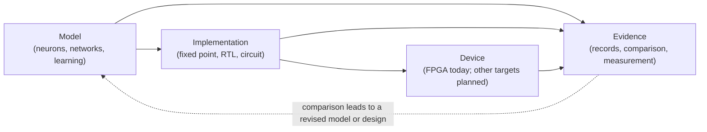

<!-- SPDX-License-Identifier: AGPL-3.0-or-later -->
<!-- Commercial license available -->
<!-- © Concepts 1996–2026 Miroslav Šotek. All rights reserved. -->
<!-- © Code 2020–2026 Miroslav Šotek. All rights reserved. -->
<!-- ORCID: 0009-0009-3560-0851 -->
<!-- Contact: www.anulum.li | protoscience@anulum.li -->
<!-- SC-NeuroCore — Architecture overview -->

# Architecture overview

This page explains how SC-NeuroCore is built today and what the wider
programme is meant to become. It is the entry point. The
[system map](SYSTEM_MAP.md) describes the package in detail, and the
[group and project map](../ecosystem.md) describes every project of the
programme and its status.

Two things are kept apart on this page, as everywhere in the documentation:
what **exists** and can be used now, and what is **planned**. A design, a
simulation, a synthesis report and a measurement on a real device establish
different facts, and none of them stands in for another.

## What it is for

The programme connects models of spiking neurons, circuit design and
hardware testing, so that a team can carry a design from an experiment to a
result that others can check and reproduce: develop a model, compare its
behaviour, implement it on a chosen target, and trace the measured result
back to the original design.

SC-NeuroCore is the existing open-source workbench of that programme.

## The loop the programme is built around

Every arrow into "Evidence" is a record of what was actually run, with the
exact inputs and tools. The dashed arrow is what makes it a loop: a
comparison shows where model and implementation differ, and the next
revision starts from there. The [group and project map](../ecosystem.md)
shows the same loop across all four programme lines, including the planned
general circuit platform and the optional laboratory and production
integration.

## What exists today: three tiers in one package

| Tier | Where | What it does |
| --- | --- | --- |
| Simulation | `src/sc_neurocore/` | Neuron and synapse models, stochastic-computing arithmetic, the network engine, learning rules and analysis, in Python |
| Compiled engine | `engine/`, `crates/`, `src/sc_neurocore/accel/` | The same arithmetic in compiled form: a Rust engine with Python bindings, and further kernels in other languages |
| Hardware | `hdl/`, `src/sc_neurocore/compiler/`, `src/sc_neurocore/hdl_gen/`, `src/sc_neurocore/asic_flow/` | Generated and hand-written Verilog, the compiler from model to RTL, and flow scripts for FPGA and ASIC tools |

The design choice underneath all three is stochastic computing: a value is
carried as a stream of bits, so that multiplication becomes a single logic
gate. That makes the digital hardware small, and it makes the software model
and the hardware comparable bit by bit.

The experimental visual interface, SNN Studio, sits on top of these tiers.
It has its own [manual](../studio/manual/index.md).

Current counts of models, tests and modules are generated from the source
tree and published in the
[capability snapshot](../_generated/capability_snapshot.md). This page
states none, so that it cannot go stale.

## The contracts that hold the tiers together

1. **One arithmetic, several implementations.** The accelerated path and
   the reference path of the public inference entry point give identical
   bits for the same seed. Where a faster implementation exists, it is
   checked against the reference, not trusted.
2. **Fixed point is a model of its own.** The fixed-point reference is a
   bit-true description of what the hardware computes. How far it is from
   the floating-point model is a separate question with its own answer; for
   the spoken-digits pipeline the repository's `ARCHITECTURE.md` states that
   gap beside the bit-exact result.
3. **Generated hardware is compared with its reference.** Co-simulation
   runs the Verilog and the fixed-point reference on the same stimulus and
   compares them. For the spoken-digits pipeline described in the
   repository's `ARCHITECTURE.md`, that comparison is bit-exact; the design
   has been synthesised; it has not yet been run on a board.
4. **A result carries its record.** An evidence pack exported from the
   Studio carries a receipt on each piece of evidence, and anyone who
   receives the pack can recheck it from disk
   ([how](../studio/evidence-verification.md)). A receipt says what was run
   or what the exporter received, and says which of the two. It does not
   say that the model is right.
5. **Unsupported is said, not guessed.** The aim is that a model, method
   or target that is not supported is refused with its reason, and that no
   fallback changes what a model means without saying so. The system map
   records cases where this already holds, for example a field solver that
   fails closed when its runtime is missing instead of returning made-up
   data.

### How each contract is checked today

| Contract | Check | Reach |
| --- | --- | --- |
| 1 | `tests/test_sc_forward_bit_identical.py` | Exact equality of the accelerated and the reference path for one seed, over three layer shapes and three stream lengths. Hosted runs require the compiled engine. |
| 2 | Stated per pipeline in the repository's `ARCHITECTURE.md` | One pipeline. No automated check holds the stated gap. |
| 3 | A hosted step runs `hdl/test_shd_axi.sh` and three co-simulation tools, one per stage of the spoken-digits pipeline; `tests/test_shd_int_core_cosim.py` compares the integer core with its reference | The stages and the integer core, on every change. The whole-pipeline comparison is run by hand with `tools/cosim_shd_top_verilog.py` and needs extracted weights. |
| 4 | `tests/test_studio_evidence_chain.py`, `tests/test_tools_studio_evidence_verify.py`, `tests/test_studio_evidence_seal.py` and the browser-side seal test | Packs exported from the Studio, on both runtimes. |
| 5 | The refusal tests of each surface | Per surface. Elsewhere it is an aim. |

What each kind of evidence shows, and what it does not, is set out in
[Evidence: what each kind establishes](evidence.md).

## What we integrate and what we build

SC-NeuroCore does not replace the established tools of its field. It
connects to them, and builds only what is missing between them.

| Area | Established tools and standards we work with | How |
| --- | --- | --- |
| Interchange of spiking networks | NIR; snnTorch and Sinabs through NIR | Optional install groups; import and export with stated losses |
| Model description formats | NeuroML 2, SONATA | Optional install groups; adapters registered through an entry-point group |
| Numerical computing | PyTorch, JAX, CuPy, Numba, MPI, Julia | Optional install groups; none is needed for the base package |
| Hardware tools | Yosys, nextpnr, OpenROAD, Icarus Verilog, SymbiYosys, Vivado, firtool, Lean | Called as installed tools by the compiler and flow modules, or named in the flow files they generate; never bundled |
| Quantum frameworks | Qiskit, PennyLane | Optional install group, experimental |

What we build ourselves is the part between these tools: the
stochastic-computing arithmetic, the bit-true path from a model to RTL, the
comparison of every stage with its reference, and the records that make a
result checkable.

New adapters join without a change to the core: the package discovers them
through the entry-point group `sc_neurocore.adapters`.

## What ships and what is research

The package has three levels of maturity, set out in the
[package boundary decision](package_boundary_decision.md):

- **Core** is installed with the wheel and is the supported surface.
- **Research** modules are in the source tree and excluded from the wheel.
  They work, and they carry no support promise.
- **Exploratory material** under the repository's `research/` directory is
  not importable as part of the package and is outside this architecture.

The system map directs that the Studio present only core capabilities as
supported.

## What it is meant to become

The [group and project map](../ecosystem.md) is the authoritative
description. In short:

- The workbench's responsibilities are planned to become separately
  released components with versioned interfaces, once the integrated
  package has reached its stability gates. Until then, users continue with
  the existing package.
- A family of measurement and evidence tools is planned around it, so that
  a claim about timing, data quality, numerical agreement or deployment can
  be traced to its source.
- A general circuit-design platform is planned, for analogue, digital and
  mixed-signal designs. Neuromorphic designs would be one application of
  it.
- An optional path to laboratory and production integration is planned. It
  would connect design identities to approved processes, equipment and
  measured hardware. Local controllers and manufacturing authorities keep
  their responsibilities.

None of these is announced as available. Each project's actual state is on
the map.

## Principles

- **Evidence before claims.** A number in the documentation should be bound
  to the artefact it comes from; where a test enforces that, the page says
  so.
- **Integrate before building.** If an established tool does the job, we
  connect to it.
- **Each domain keeps its own laws.** Digital exactness, analogue error and
  physical measurement are different kinds of statement and are never
  merged.
- **Local and offline first.** The base package needs no service, no
  account and no network.
- **Open by construction.** A new model, adapter or tool should be able to
  join without a change to the parts that already work.

## Where to read next

- [System map](SYSTEM_MAP.md): the package in detail, with source references.
- [Evidence](evidence.md): what each kind of evidence shows and does not show.
- [Group and project map](../ecosystem.md): every project and its status.
- [Product overview](../product_overview.md): today's workflow.
- [Evidence boundary](../benchmarks/cross_framework.md): how to read results.
- [Installation profiles](../guides/install_profiles.md) and
  [getting started](../guides/getting-started.md).
