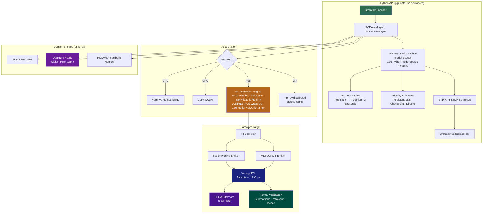

<!--
SPDX-License-Identifier: AGPL-3.0-or-later
Commercial license available
© Concepts 1996–2026 Miroslav Šotek. All rights reserved.
© Code 2020–2026 Miroslav Šotek. All rights reserved.
ORCID: 0009-0009-3560-0851
Contact: www.anulum.li | protoscience@anulum.li
SC-NeuroCore — Package architecture
-->

# Package Architecture

This text was part of the repository README until the README became a short landing page.

## Module Tiers

`pip install sc-neurocore` ships **Core + Simulation + Domain bridges** only.
Research and extended modules are available from source (`pip install -e ".[dev]"`).

| Tier | Modules | Ships in wheel | Status |
|------|---------|:--------------:|--------|
| **Core** | neurons, synapses, layers, sources, utils, recorders, accel, compiler, hdl_gen, hardware, cli, exceptions | Yes | Supported core surface of the beta package; current CI coverage gate is 100% of the measured files. [What the gate measures and omits](https://github.com/anulum/sc-neurocore/blob/main/VALIDATION.md) is generated from the coverage configuration. |
| **Simulation** | hdc, solvers, transformers, learning, graphs, ensembles, export, pipeline, profiling, models, math, spatial, verification, security | Yes | Stable. Import explicitly. |
| **Industrial** | safety_cert, asic_flow, fault_injection, uvm_gen, hypervisor, digital_twin, chiplet, spintronic, memristor, analog_bridge | No | Source-only; see `docs/MODULE_INTEGRATION.md` for the historical 19-module integration slice. |
| **Extended research** | evo_substrate, meta_plasticity, bioware, federated, bci_studio, explainability, neuro_symbolic, stochastic_doctor, model_zoo | No | Source-only; see `docs/MODULE_INTEGRATION.md` for the historical 19-module integration slice. |
| **Domain bridges** | quantum (Qiskit/PennyLane), bridges/quantum_annealing (Ising/QUBO), adapters/holonomic (JAX), scpn (Petri nets) | Yes | Heavy backends require the `[quantum]`, `[annealing]`, or `[jax]` extra |
| **Research** | robotics, physics, bio, optics, chaos, sleep, interfaces | No | Tested. Available from source. |
| **Speculative** | `research/` (eschaton, exotic, meta, post_silicon, transcendent) | No | Theoretical. See `research/README.md`. |

The source-only optics surface preserves its historical API through bounded
photonic-emitter responsibility modules. FDTD, Meep, netlist, and GDSII work
remain Python-only; the engine and executable Rust/Go/Julia/Mojo mirrors cover
the coupled-mode crosstalk kernel only. Local timing evidence is explicitly
non-isolated and is not a production-throughput claim.

The safety_cert package is a source-only, library-only safety-evidence
organiser. It materialises hash-bound reports from explicit inputs; it does not
issue certification or regulatory approval.

## Architecture Diagram



## Core API subset (28 of 45 public exports)

```python
from sc_neurocore import (
    # Neurons
    StochasticLIFNeuron,
    FixedPointLIFNeuron,
    FixedPointLFSR,
    FixedPointBitstreamEncoder,
    HomeostaticLIFNeuron,
    StochasticDendriticNeuron,
    SCIzhikevichNeuron,
    # Synapses
    BitstreamSynapse,
    BitstreamDotProduct,
    StochasticSTDPSynapse,
    RewardModulatedSTDPSynapse,
    # Layers
    SCDenseLayer,
    SCConv2DLayer,
    SCLearningLayer,
    VectorizedSCLayer,
    SCRecurrentLayer,
    MemristiveDenseLayer,
    SCFusionLayer,
    StochasticAttention,
    # Utilities
    BitstreamEncoder,
    BitstreamAverager,
    RNG,
    generate_bernoulli_bitstream,
    generate_sobol_bitstream,
    bitstream_to_probability,
    # Sources & Recorders
    BitstreamCurrentSource,
    BitstreamSpikeRecorder,
)
```

## Hardware (Verilog RTL)

```
hdl/
  sc_bitstream_encoder.v      -- LFSR-based stochastic encoder (SEED_INIT param)
  sc_bitstream_synapse.v      -- AND-gate SC multiplier
  sc_mux_add.v                -- 2-input MUX (scaled addition)
  sc_cordiv.v                 -- CORDIV stochastic divider (Chen and Hayes 2016)
  sc_dotproduct_to_current.v  -- Popcount -> fixed-point current
  sc_lif_neuron.v             -- Q8.8 leaky integrate-and-fire
  sc_firing_rate_bank.v       -- Spike rate estimator
  sc_dense_layer_core.v       -- Full dense layer pipeline (decorrelated seeds)
  sc_dense_matrix_layer.v     -- N×M weight matrix layer
  sc_axil_cfg.v               -- AXI-Lite register file
  sc_axil_cfg_param.v         -- Parameterized AXI-Lite register file
  sc_axis_interface.v         -- AXI-Stream bulk bitstream I/O
  sc_dma_controller.v         -- DMA for weight upload and output readback
  sc_cdc_primitives.v         -- Clock domain crossing (2-FF sync, Gray, async FIFO)
  sc_dense_layer_top.v        -- Dense layer top wrapper
  sc_neurocore_top.v          -- AXI-Lite dense-layer measurement and rate readback
  sc_aer_encoder.v            -- AER spike encoder (event-driven output)
  sc_event_neuron.v           -- Event-triggered LIF (membrane updates on events and leak ticks)
  sc_aer_router.v             -- AER event distribution to target neurons
  tb_sc_*.v                   -- Self-checking simulation testbenches
  formal/ (92 proof jobs)     -- catalogue model checks + legacy SC cores
```

Formal verification inventory: **92 SymbiYosys proof jobs and 591 formal
statements (403 assert, 133 assume, 55 cover)** in `hdl/formal/` and the inline
top-wrapper properties (20 non-catalogue jobs + **72 catalogue jobs** under
`hdl/formal/catalogue/`). This counts unique job configurations and statements,
including the inline `FORMAL` block in `hdl/sc_neurocore_top.v`; it is not a
count of qualified passing results. Full qualification remains incomplete,
so `formal-all` is expected to remain red, and full formal qualification is
not claimed until it is honestly green. See [external formal evidence](../formal/external_results.md).
Re-emit catalogue harnesses with `tools/emit_catalogue_formal.py`.

## GPU Acceleration

```python
from sc_neurocore.accel import xp, HAS_CUPY, to_device, to_host
from sc_neurocore.accel.gpu_backend import gpu_vec_mac

# VectorizedSCLayer auto-detects GPU
layer = VectorizedSCLayer(n_inputs=32, n_neurons=64, length=1024)
output = layer.forward(input_values)  # GPU if CuPy available, else CPU
```

## Native compute graph IR

The Rust and Python graph builders provide typed integer circuits with explicit
casts, rounding and saturation, source-bound text persistence, state registers
and SystemVerilog/CIRCT emission. The public `compile_to_ir` frontend lowers
supported equation models into these operations; `recompile_ir` checks source
replay against the saved graph. See the [equation API and supported modes](../api/equation-native-ir.md)
and [scalar word and naming contract](../api/sc-ir.md).

The [function-call numeric contract](../guides/function_call_domains.md)
reports encoded argument bounds and numerical error separately for every
approximation call. It distinguishes conservative interval hulls from reachable
states and records mathematical-domain exclusions and sampled measurements.
