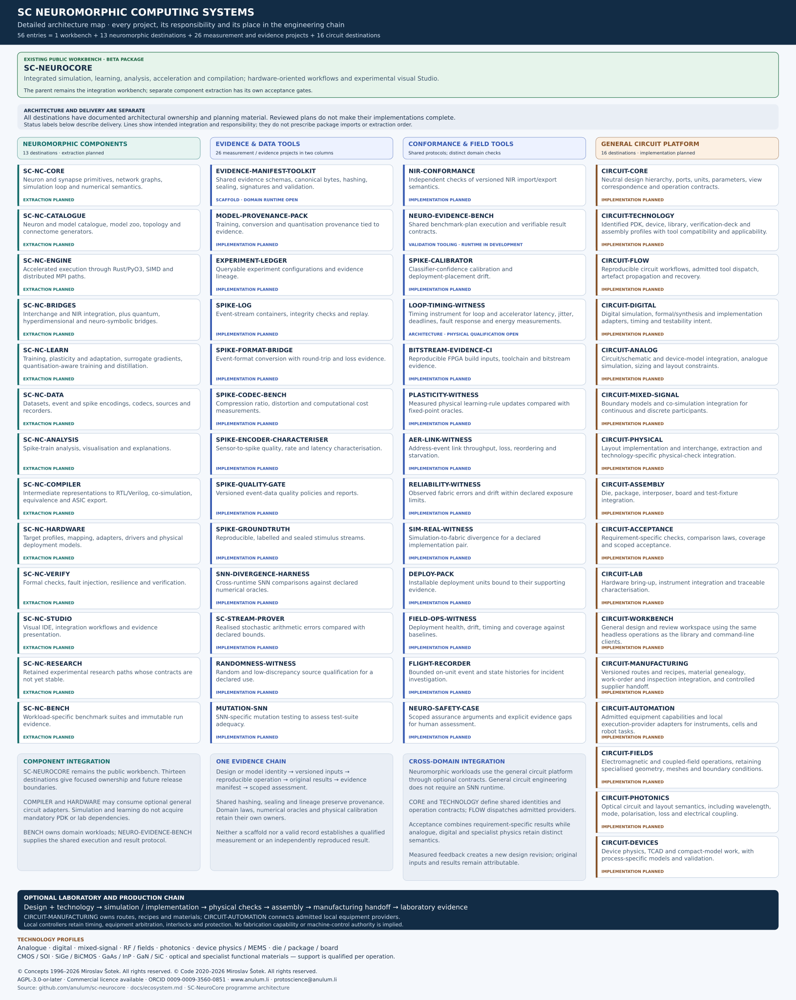
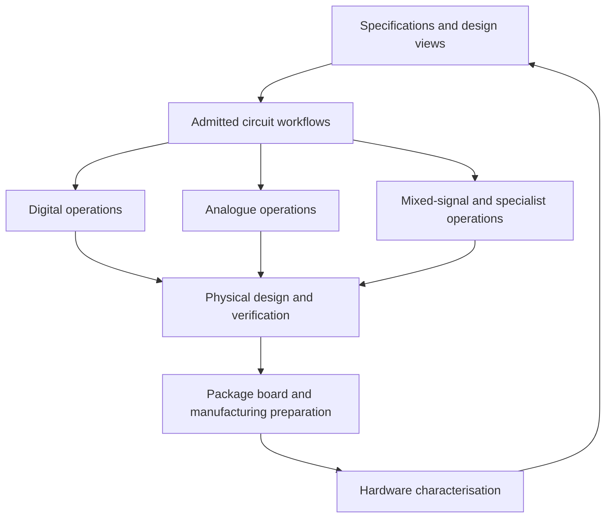

<!-- SPDX-License-Identifier: AGPL-3.0-or-later -->
<!-- Commercial license available -->
<!-- © Concepts 1996–2026 Miroslav Šotek. All rights reserved. -->
<!-- © Code 2020–2026 Miroslav Šotek. All rights reserved. -->
<!-- ORCID: 0009-0009-3560-0851 -->
<!-- Contact: www.anulum.li | protoscience@anulum.li -->
<!-- SC-NeuroCore — Group and project map -->

# Group and Project Map

**SC-NeuroCore will remain a public, open-source development workbench** for the
**SC Neuromorphic Computing Systems** group. The upcoming split gives focused
repositories clear responsibilities, smaller installation boundaries and
versioned interfaces. The workbench continues to bring those parts together for
experimentation, research-to-hardware workflows and integration.

The existing programme comprises the workbench, LOOP-TIMING-WITNESS, 13 specialized SC-NC
repositories and 25 supporting tools. The repository names below identify the
intended destinations; implementation and release status are separate from naming.

The split architecture is prepared. The current integrated package retains
its documented maturity; separately published component releases and migration
guides will accompany the transition. See the repository releases for the
current version.

## Public workbench and future products

SC-NeuroCore keeps its public workbench role and current open-source license.
Future specialized components may become open-source or proprietary products.
Their licensing and commercial boundaries remain under discussion with investors
and IP partners and will be announced individually. Several supporting tools
will remain public, with their own documented licensing and release status.

The map below covers that existing programme. The adopted general circuit-design
expansion is described separately below. Future
licensing decisions will be announced separately for each project.

[Open the full-size SVG](assets/sc_neurocore_group_map.svg),
[download PNG](assets/sc_neurocore_group_map.png), or
[download JPG](assets/sc_neurocore_group_map.jpg) (3200 × 3740 pixels).
The map groups responsibilities for navigation; its connecting lines do not
specify package dependencies or an extraction order.

## What exists today

| Repository | Function | Current status |
| --- | --- | --- |
| [SC-NEUROCORE](https://github.com/anulum/sc-neurocore) | Integrated development workbench: simulation, learning, analysis, acceleration, compilation and hardware-oriented evidence. | Existing repository and Python package; package metadata remains at beta maturity. Individual capabilities have their own evidence boundaries. |
| [LOOP-TIMING-WITNESS](https://github.com/anulum/loop-timing-witness) | Timing instrument for loop and accelerator latency, jitter, deadlines, fault response and energy measurements. | Architecture stage, with software/native/RTL simulation and measurement contracts. Physical board qualification remains pending. |
| EVIDENCE-MANIFEST-TOOLKIT | Portable evidence-manifest contracts and validation infrastructure. | Existing architecture-stage scaffold with local repository checks. No released signing, verification or domain runtime package. |

The remaining specialized repositories and supporting tools are planned.
A place on this map does not imply an available package, completed extraction or
qualified hardware. Published repositories and releases will provide their own
installation instructions, compatibility contracts and evidence.

## Why split the workbench

A modeller should be able to work with neuron primitives and analysis without
installing an FPGA toolchain. A hardware engineer should find compilation and
target integration together. A team checking results should be able to use an
evidence tool through a documented contract. Focused repositories make these
entry points easier to understand and maintain.

SC-NeuroCore keeps its role as the place to develop and integrate the complete
workflow. It will continue to support experiments spanning several components
and provide a practical route through the group. Specialized repositories will
own their implementations and public interfaces; shared functionality should
be consumed through those interfaces rather than copied between repositories.

## Specialized repositories

All 13 repositories in this section are planned extraction destinations.
Their functions describe ownership, not separate releases already available.

### Foundation and execution

| Repository | Function |
| --- | --- |
| **SC-NC-CORE** | Neuron and synapse primitives, network graphs, simulation loop and numerical semantics. |
| **SC-NC-CATALOGUE** | Neuron and model catalogue, model zoo, topology and connectome generators. |
| **SC-NC-ENGINE** | Accelerated execution through Rust/PyO3, SIMD and distributed MPI paths. |
| **SC-NC-BRIDGES** | Interchange and NIR integration, plus quantum, hyperdimensional and neuro-symbolic bridges. |

### Learning and data

| Repository | Function |
| --- | --- |
| **SC-NC-LEARN** | Training, plasticity and adaptation, surrogate gradients, quantisation-aware training and distillation. |
| **SC-NC-DATA** | Datasets, event and spike encodings, codecs, sources and recorders. |
| **SC-NC-ANALYSIS** | Spike-train analysis, visualisation and explanations. |

### Silicon and verification

| Repository | Function |
| --- | --- |
| **SC-NC-COMPILER** | Intermediate representations to RTL/Verilog, co-simulation, equivalence and ASIC export. |
| **SC-NC-HARDWARE** | Target profiles, mapping, adapters, drivers and physical deployment models. |
| **SC-NC-VERIFY** | Formal checks, fault injection, resilience and verification. |

### Workspace and research

| Repository | Function |
| --- | --- |
| **SC-NC-STUDIO** | Visual IDE, integration workflows and evidence presentation. |
| **SC-NC-RESEARCH** | Retained experimental research paths whose contracts are not yet stable. |
| **SC-NC-BENCH** | Workload-specific benchmark suites and immutable run evidence. |

## Supporting tools

These 25 tools are sibling projects serving the group through explicit data,
measurement and evidence contracts. They complement the SC-NC components and
have separate responsibilities. EVIDENCE-MANIFEST-TOOLKIT has the scaffold
status described above; the other tools below are planned.

### Evidence and lineage

| Tool | Intended function |
| --- | --- |
| **EVIDENCE-MANIFEST-TOOLKIT** | Shared evidence schemas, canonical bytes, hashing, sealing, signatures and validation. |
| **MODEL-PROVENANCE-PACK** | Training, conversion and quantisation provenance tied to evidence. |
| **EXPERIMENT-LEDGER** | Queryable experiment configurations and evidence lineage. |
| **SPIKE-LOG** | Event-stream containers, integrity checks and replay. |

### Data and encoders

| Tool | Intended function |
| --- | --- |
| **SPIKE-FORMAT-BRIDGE** | Event-format conversion with round-trip and loss evidence. |
| **SPIKE-CODEC-BENCH** | Compression ratio, distortion and computational cost measurements. |
| **SPIKE-ENCODER-CHARACTERISER** | Sensor-to-spike quality, rate and latency characterisation. |
| **SPIKE-QUALITY-GATE** | Versioned event-data quality policies and reports. |
| **SPIKE-GROUNDTRUTH** | Reproducible, labelled and sealed stimulus streams. |

### Numerical behaviour and conformance

| Tool | Intended function |
| --- | --- |
| **SNN-DIVERGENCE-HARNESS** | Cross-runtime SNN comparisons against declared numerical oracles. |
| **SC-STREAM-PROVER** | Realised stochastic arithmetic errors compared with declared bounds. |
| **RANDOMNESS-WITNESS** | Random and low-discrepancy source qualification for a declared use. |
| **MUTATION-SNN** | SNN-specific mutation testing to assess test-suite adequacy. |
| **NIR-CONFORMANCE** | Independent checks of versioned NIR import/export semantics. |
| **NEURO-EVIDENCE-BENCH** | Shared benchmark-plan execution and verifiable result contracts. |
| **SPIKE-CALIBRATOR** | Classifier-confidence calibration and deployment-placement drift. |

### Hardware measurements

| Tool | Intended function |
| --- | --- |
| **BITSTREAM-EVIDENCE-CI** | Reproducible FPGA build inputs, toolchain and bitstream evidence. |
| **PLASTICITY-WITNESS** | Measured physical learning-rule updates compared with fixed-point oracles. |
| **AER-LINK-WITNESS** | Address-event link throughput, loss, reordering and starvation. |
| **RELIABILITY-WITNESS** | Observed fabric errors and drift within declared exposure limits. |
| **SIM-REAL-WITNESS** | Simulation-to-fabric divergence for a declared implementation pair. |

### Deployment and assurance

| Tool | Intended function |
| --- | --- |
| **DEPLOY-PACK** | Installable deployment units bound to their supporting evidence. |
| **FIELD-OPS-WITNESS** | Deployment health, drift, timing and coverage against baselines. |
| **FLIGHT-RECORDER** | Bounded on-unit event and state histories for incident investigation. |
| **NEURO-SAFETY-CASE** | Scoped assurance arguments and explicit evidence gaps for human assessment. |

SC-NC-BENCH owns workload-specific benchmark suites and their run evidence.
NEURO-EVIDENCE-BENCH provides the shared plan-execution and result protocol that
those suites and Studio can consume. LOOP-TIMING-WITNESS measures timing;
AER-LINK-WITNESS assesses event-link behaviour. These boundaries keep domain
workloads, shared tooling and physical measurements distinct.

## General circuit-design platform

The group is designing a general platform connecting circuit specifications,
simulation, implementation, physical design, assembly and measured hardware.
It is intended for analogue, digital and mixed-signal designs from the beginning,
with explicit extension points for other physical domains and technologies.
SC-NeuroCore would be one application of that platform; the general platform
would be usable without neuron models or an SNN runtime.

**Status: adopted architectural direction; implementation is planned.** The
sixteen names below are the adopted destinations for the new family. They do
not identify available packages or newly created public repositories. Actual
tool, process, device and manufacturing support must be
qualified for each operation and published with its limitations. There is no
announced tapeout, manufacturing schedule or universal technology-support claim.

### Coverage and separate semantics

| Design family | Intended scope and distinct requirements |
| --- | --- |
| Digital | Synchronous and asynchronous logic, control, processors, accelerators and memories; FPGA and ASIC implementations, clocks/reset, equivalence, timing and testability. |
| Analogue | Signal conditioning, references, filters, oscillators, sensors and power circuits; continuous device behaviour, stability, noise, variability and operating limits. |
| Mixed-signal | Data converters, timing circuits, sensor interfaces and digitally assisted analogue; explicit sampling, thresholds, event timing and continuous/discrete coupling. |
| RF and coupled fields | RF/microwave structures, signal/power integrity and electrothermal or electromechanical effects; specialised models, geometry, meshes and boundary conditions. |
| Photonic and optoelectronic | Optical circuit/layout models and electrical coupling, with wavelength, mode, polarisation and optical-loss semantics. |
| Device and specialist technologies | Process/device modelling, specialised memories, MEMS and research extensions such as cryogenic circuits, each with its own supported models and validation. |
| Assembly and boards | Die/package/interposer/PCB interfaces, discrete components, heterogeneous chiplets and stacked systems, test fixtures and bring-up. |

Technology profiles would distinguish silicon CMOS/SOI and device families,
SiGe/BiCMOS and high-voltage processes, compound or wide-bandgap materials such
as GaAs, InP, GaN and SiC, optical platforms and specialised functional materials.
Material, substrate, device, process, layout stack and package are separate
attributes. Adding one profile would not imply support for every design or
operation using that material. Emerging or research models would retain their
research status.

### Planned platform repositories

| Repository | Planned responsibility |
| --- | --- |
| **CIRCUIT-CORE** | Neutral design hierarchy, ports, units, parameters, view correspondence and operation contracts. |
| **CIRCUIT-TECHNOLOGY** | Identified PDK, device, library, verification-deck and assembly profiles with tool compatibility and applicability. |
| **CIRCUIT-FLOW** | Reproducible circuit workflows, admitted tool dispatch, artefact propagation and recovery. |
| **CIRCUIT-DIGITAL** | Digital simulation, formal/synthesis and implementation adapters, timing and testability intent. |
| **CIRCUIT-ANALOG** | Circuit/schematic and device-model integration, analogue simulation, sizing and layout constraints. |
| **CIRCUIT-MIXED-SIGNAL** | Boundary models and co-simulation integration for continuous and discrete participants. |
| **CIRCUIT-PHYSICAL** | Layout implementation and interchange, extraction and technology-specific physical-check integration. |
| **CIRCUIT-ASSEMBLY** | Die, package, interposer, board and test-fixture integration. |
| **CIRCUIT-ACCEPTANCE** | Requirement-specific checks, comparison laws, coverage and scoped acceptance. |
| **CIRCUIT-LAB** | Hardware bring-up, instrument integration and traceable characterisation. |
| **CIRCUIT-WORKBENCH** | General design and review workspace using the same headless operations as the library and command-line clients. |
| **CIRCUIT-MANUFACTURING** | Versioned routes and recipes, material genealogy, work-order and inspection integration, and controlled supplier handoff. |
| **CIRCUIT-AUTOMATION** | Admitted equipment capabilities and local execution-provider adapters for instruments, cells and robot tasks. |

Three further planned specialist destinations are **CIRCUIT-FIELDS** for electromagnetic
and coupled-field operations, **CIRCUIT-PHOTONICS** for optical design semantics,
and **CIRCUIT-DEVICES** for device/TCAD and compact-model work. Their independent
repositories depend on actual supported use cases, maintainers and release
boundaries. A distinct material, node or adapter does not automatically require
another repository. Every destination follows a module-first implementation decision; shared foundation packages
may initially live in one workspace. Separate repositories require independent
consumers, lifecycle and maintainers. CIRCUIT-ACCEPTANCE aggregates requirement
results; SC-NC-VERIFY retains SNN fidelity and digital formal operations remain
with their actual tool owners.

### Integration model

The arrows describe an intended lifecycle. Individual views and operations keep
their own semantics and entry points; an existing RTL, schematic, netlist or
layout can enter at the appropriate stage. Iterations produce versioned successor
designs and preserve their original inputs and results.

The first integration route uses existing open-source tools. Candidates include
[Yosys/OpenROAD/KLayout through OpenROAD-flow-scripts](https://github.com/The-OpenROAD-Project/OpenROAD-flow-scripts),
[xschem](https://xschem.sourceforge.io/stefan/xschem_man/netlisting.html),
[ngspice with supported compact models and digital co-simulation](https://ngspice.sourceforge.io/extras.html),
and [KiCad](https://docs.kicad.org/) for board integration. Specialist tools and
commercial flows would be admitted through explicit tool/technology contracts.
Existing workflow and representation infrastructure, including
[SiliconCompiler](https://docs.siliconcompiler.com/en/latest/),
[LibreLane](https://librelane.readthedocs.io/en/stable/) and
[CIRCT](https://circt.llvm.org/), would be evaluated before building equivalent
functionality. Relevant [Accellera interface and verification standards](https://www.accellera.org/downloads/standards)
would inform supported interchange contracts. Own tools would address
demonstrated integration or engineering requirements.
PDK and IP access, applicable licences and manufacturer requirements remain
specific to the selected target; open tooling alone does not establish
production readiness.

The general platform would reuse the existing evidence, record and measurement
contracts as those capabilities become available. Tool operations would treat designs, PDK decks and embedded scripts as
untrusted executable inputs, with explicit isolated execution and bounded
resources. Instrument drivers and original calibration associations would have
one source owner. It would preserve original
artefacts and distinguish simulated, implemented, manufacturer-accepted and
measured results. Digital exactness, analogue error/statistical laws and
specialist physics would retain separate acceptance criteria.

### Manufacturing and laboratory automation

Manufacturing is an optional integration path. Circuit design and simulation
would remain usable without a laboratory, production line or manufacturing
execution system. The supported modes would distinguish supplier handoff,
operator-owned equipment and non-actuating qualification or replay.

CIRCUIT-MANUFACTURING would bind design and technology identities to approved
routes, recipe versions, material genealogy, work orders and inspection results.
It would integrate an existing manufacturing authority and its records rather
than introduce a competing factory-management system. CIRCUIT-AUTOMATION would
provide explicit equipment capabilities and adapters to qualified local execution
providers. Instruments shared with CIRCUIT-LAB would retain one canonical driver
and their original calibration associations.

Platform workflows would dispatch admitted operations through CIRCUIT-FLOW.
Actual control-loop timing, equipment arbitration, interlocks and protective
responses would remain with the qualified local controller and site authority.
A circuit view, manufacturing recipe, robot task and measurement record would
keep distinct semantics. Lost acknowledgements or restarts must be reconciled
against actual equipment state; they cannot authorise blind physical replay.

The first operating integration would use read-only equipment observations and
real material records. Supervised operations, robot handling, lithography or
other specialist processes would require their own selected equipment, process
window, calibration, inspection, failure and recovery evidence. Bounded unattended
operation would require an explicit qualified operating envelope and intervention
path. No automated fabrication capability or machine-control permission is
announced by this architecture.

### Effect on the SC-NeuroCore split

The thirteen SC-NC destinations remain the neuromorphic decomposition.
SC-NC-COMPILER would retain model-specific numerical semantics and lowering;
SC-NC-HARDWARE would retain SNN target and runtime integration. They could
consume admitted general circuit operations through optional adapters.
SC-NC-VERIFY would retain domain fidelity checks, and SC-NC-STUDIO could expose
those operations to its users.

Execution profiles would support admitted local, cloud, cluster and future
environments; the architecture is not tied to the current machines. Actual
provider resources, data/IP access and isolation would be checked per operation.

The generic platform would have no production dependency on SC-NeuroCore.
Simulation and learning users would not acquire mandatory PDK, physical-design
or laboratory installations. The existing parent-stability and separately
reviewed extraction gates still apply. Open implementation, native-runtime,
scientific and hardware obligations remain requirements of their actual
components; an architecture document does not complete them.

### Development roadmap

| Milestone | Intended result | Evidence required before claiming it |
| --- | --- | --- |
| Architecture and interfaces | Accepted ownership, design/view and technology contracts, tool boundaries and compatibility policy. | Reviewed interfaces and actual consumers, with supported and unsupported cases explicit. |
| Qualified design operations | Usable digital and analogue operations with selected real tools and technology profiles. | Installed library/CLI workflows, actual simulation/implementation outputs and engineering checks, including failures and recovery. |
| Integrated mixed-signal workflow | Real continuous/discrete participants and a workbench over the same headless operations. | Non-neural digital, analogue and mixed reference designs, cross-view correspondence, coupling/error checks and reproducibility. |
| Manufacturing preparation | Consistent physical, die/package/board and test deliverables for a selected target. | Applicable physical checks, testability, actual manufacturer review and accepted fabrication/assembly conditions. |
| Measured hardware and extensions | Characterised implementations and independently qualified specialist profiles. | Original DUT/instrument/calibration identities, uncertainty, measured-versus-predicted results and compatibility evidence. |
| Qualified manufacturing operations | Selected supplier, laboratory or cell integration with controlled material and process records. | Real read-only provider round-trips, approved route/recipe identities, qualified local protection, supervised operation and inspection/recovery evidence before physical or unattended claims. |

Architecture and interface review is the current stage. Implementation stages
depend on accepted boundaries, supplier contracts and actual engineering
capacity. Publicly documented measured designs, such as the
[OpenFASOC temperature-sensor tapeout](https://openfasoc.readthedocs.io/en/latest/tapeouts.html),
would provide external comparison references after their source/data and
measurement conditions are admitted.

These milestones describe intended capability and acceptance. They carry no
release dates and do not announce packages, fabricated devices or specialist
support that has not been demonstrated. The original workbench and component
transition continues under its existing stability and migration requirements.

## How the transition will work

The retained programme must reach its evidenced stability gates before
extraction. Each component then needs a reviewed API, dependency boundary,
packaging contract, compatibility checks and a migration guide. The workbench
will integrate components through those contracts as they become available.
There is no announced split date or migration deadline.

For current use, continue with the existing
[SC-NeuroCore installation profiles](guides/install_profiles.md) and
[getting-started guide](guides/getting-started.md). This map introduces the
repository organization; it does not announce a package-name change or ask
users to migrate now. Release notes and migration guides will describe any
future import or installation changes before users need to act.

Use the [product overview](product_overview.md) for today's workflow and
[evidence boundary](benchmarks/cross_framework.md) when evaluating results.
Measurement, verification and assurance tools will report scoped evidence;
certification and deployment approval require the applicable human assessment.
