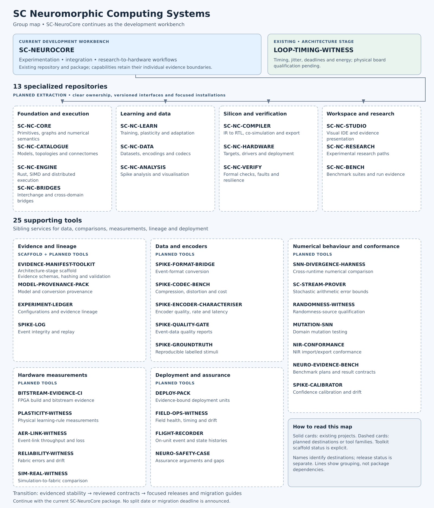

<!-- SPDX-License-Identifier: AGPL-3.0-or-later -->
<!-- Commercial license available -->
<!-- © Concepts 1996–2026 Miroslav Šotek. All rights reserved. -->
<!-- © Code 2020–2026 Miroslav Šotek. All rights reserved. -->
<!-- ORCID: 0009-0009-3560-0851 -->
<!-- Contact: www.anulum.li | protoscience@anulum.li -->
<!-- SC-NeuroCore — Group and project map -->

# Group and Project Map

**SC-NeuroCore will remain a public, open-source development workbench** for the
**SC Neuromorphic Computing Systems** group. The upcoming split gives focused
repositories clear responsibilities, smaller installation boundaries and
versioned interfaces. The workbench continues to bring those parts together for
experimentation, research-to-hardware workflows and integration.

The group comprises the workbench, LOOP-TIMING-WITNESS, 13 specialized SC-NC
repositories and 25 supporting tools. The repository names below identify the
intended destinations; implementation and release status are separate from naming.

The split architecture is prepared and is **not part of the 4.0.0 release**.
SC-NeuroCore 4.0.0 is published as one package at its documented maturity;
component releases and migration guides will accompany the transition.

## Public workbench and future products

SC-NeuroCore keeps its public workbench role and current open-source license.
Future specialized components may become open-source or proprietary products.
Their licensing and commercial boundaries remain under discussion with investors
and IP partners and will be announced individually. Several supporting tools
will remain public, with their own documented licensing and release status.

The map below describes responsibilities and implementation status. Future
licensing decisions will be announced separately for each project.

[Open the full-size SVG](assets/sc_neurocore_group_map.svg),
[download PNG](assets/sc_neurocore_group_map.png), or
[download JPG](assets/sc_neurocore_group_map.jpg) (3200 × 3740 pixels).
The map groups responsibilities for navigation; its connecting lines do not
specify package dependencies or an extraction order.

## What exists today

| Repository | Function | Current status |
| --- | --- | --- |
| [SC-NEUROCORE](https://github.com/anulum/sc-neurocore) | Integrated development workbench: simulation, learning, analysis, acceleration, compilation and hardware-oriented evidence. | Existing repository and Python package; package metadata remains at beta maturity. Individual capabilities have their own evidence boundaries. |
| [LOOP-TIMING-WITNESS](https://github.com/anulum/loop-timing-witness) | Timing instrument for loop and accelerator latency, jitter, deadlines, fault response and energy measurements. | Architecture stage, with software/native/RTL simulation and measurement contracts. Physical board qualification remains pending. |
| EVIDENCE-MANIFEST-TOOLKIT | Portable evidence-manifest contracts and validation infrastructure. | Existing architecture-stage scaffold with local repository checks. No released signing, verification or domain runtime package. |

The remaining specialized repositories and supporting tools are planned.
A place on this map does not imply an available package, completed extraction or
qualified hardware. Published repositories and releases will provide their own
installation instructions, compatibility contracts and evidence.

## Why split the workbench

A modeller should be able to work with neuron primitives and analysis without
installing an FPGA toolchain. A hardware engineer should find compilation and
target integration together. A team checking results should be able to use an
evidence tool through a documented contract. Focused repositories make these
entry points easier to understand and maintain.

SC-NeuroCore keeps its role as the place to develop and integrate the complete
workflow. It will continue to support experiments spanning several components
and provide a practical route through the group. Specialized repositories will
own their implementations and public interfaces; shared functionality should
be consumed through those interfaces rather than copied between repositories.

## Specialized repositories

All 13 repositories in this section are planned extraction destinations.
Their functions describe ownership, not separate releases already available.

### Foundation and execution

| Repository | Function |
| --- | --- |
| **SC-NC-CORE** | Neuron and synapse primitives, network graphs, simulation loop and numerical semantics. |
| **SC-NC-CATALOGUE** | Neuron and model catalogue, model zoo, topology and connectome generators. |
| **SC-NC-ENGINE** | Accelerated execution through Rust/PyO3, SIMD and distributed MPI paths. |
| **SC-NC-BRIDGES** | Interchange and NIR integration, plus quantum, hyperdimensional and neuro-symbolic bridges. |

### Learning and data

| Repository | Function |
| --- | --- |
| **SC-NC-LEARN** | Training, plasticity and adaptation, surrogate gradients, quantisation-aware training and distillation. |
| **SC-NC-DATA** | Datasets, event and spike encodings, codecs, sources and recorders. |
| **SC-NC-ANALYSIS** | Spike-train analysis, visualisation and explanations. |

### Silicon and verification

| Repository | Function |
| --- | --- |
| **SC-NC-COMPILER** | Intermediate representations to RTL/Verilog, co-simulation, equivalence and ASIC export. |
| **SC-NC-HARDWARE** | Target profiles, mapping, adapters, drivers and physical deployment models. |
| **SC-NC-VERIFY** | Formal checks, fault injection, resilience and verification. |

### Workspace and research

| Repository | Function |
| --- | --- |
| **SC-NC-STUDIO** | Visual IDE, integration workflows and evidence presentation. |
| **SC-NC-RESEARCH** | Retained experimental research paths whose contracts are not yet stable. |
| **SC-NC-BENCH** | Workload-specific benchmark suites and immutable run evidence. |

## Supporting tools

These 25 tools are sibling projects serving the group through explicit data,
measurement and evidence contracts. They complement the SC-NC components and
have separate responsibilities. EVIDENCE-MANIFEST-TOOLKIT has the scaffold
status described above; the other tools below are planned.

### Evidence and lineage

| Tool | Intended function |
| --- | --- |
| **EVIDENCE-MANIFEST-TOOLKIT** | Shared evidence schemas, canonical bytes, hashing, sealing, signatures and validation. |
| **MODEL-PROVENANCE-PACK** | Training, conversion and quantisation provenance tied to evidence. |
| **EXPERIMENT-LEDGER** | Queryable experiment configurations and evidence lineage. |
| **SPIKE-LOG** | Event-stream containers, integrity checks and replay. |

### Data and encoders

| Tool | Intended function |
| --- | --- |
| **SPIKE-FORMAT-BRIDGE** | Event-format conversion with round-trip and loss evidence. |
| **SPIKE-CODEC-BENCH** | Compression ratio, distortion and computational cost measurements. |
| **SPIKE-ENCODER-CHARACTERISER** | Sensor-to-spike quality, rate and latency characterisation. |
| **SPIKE-QUALITY-GATE** | Versioned event-data quality policies and reports. |
| **SPIKE-GROUNDTRUTH** | Reproducible, labelled and sealed stimulus streams. |

### Numerical behaviour and conformance

| Tool | Intended function |
| --- | --- |
| **SNN-DIVERGENCE-HARNESS** | Cross-runtime SNN comparisons against declared numerical oracles. |
| **SC-STREAM-PROVER** | Realised stochastic arithmetic errors compared with declared bounds. |
| **RANDOMNESS-WITNESS** | Random and low-discrepancy source qualification for a declared use. |
| **MUTATION-SNN** | SNN-specific mutation testing to assess test-suite adequacy. |
| **NIR-CONFORMANCE** | Independent checks of versioned NIR import/export semantics. |
| **NEURO-EVIDENCE-BENCH** | Shared benchmark-plan execution and verifiable result contracts. |
| **SPIKE-CALIBRATOR** | Classifier-confidence calibration and deployment-placement drift. |

### Hardware measurements

| Tool | Intended function |
| --- | --- |
| **BITSTREAM-EVIDENCE-CI** | Reproducible FPGA build inputs, toolchain and bitstream evidence. |
| **PLASTICITY-WITNESS** | Measured physical learning-rule updates compared with fixed-point oracles. |
| **AER-LINK-WITNESS** | Address-event link throughput, loss, reordering and starvation. |
| **RELIABILITY-WITNESS** | Observed fabric errors and drift within declared exposure limits. |
| **SIM-REAL-WITNESS** | Simulation-to-fabric divergence for a declared implementation pair. |

### Deployment and assurance

| Tool | Intended function |
| --- | --- |
| **DEPLOY-PACK** | Installable deployment units bound to their supporting evidence. |
| **FIELD-OPS-WITNESS** | Deployment health, drift, timing and coverage against baselines. |
| **FLIGHT-RECORDER** | Bounded on-unit event and state histories for incident investigation. |
| **NEURO-SAFETY-CASE** | Scoped assurance arguments and explicit evidence gaps for human assessment. |

SC-NC-BENCH owns workload-specific benchmark suites and their run evidence.
NEURO-EVIDENCE-BENCH provides the shared plan-execution and result protocol that
those suites and Studio can consume. LOOP-TIMING-WITNESS measures timing;
AER-LINK-WITNESS assesses event-link behaviour. These boundaries keep domain
workloads, shared tooling and physical measurements distinct.

## How the transition will work

The retained programme must reach its evidenced stability gates before
extraction. Each component then needs a reviewed API, dependency boundary,
packaging contract, compatibility checks and a migration guide. The workbench
will integrate components through those contracts as they become available.
There is no announced split date or migration deadline.

For current use, continue with the existing
[SC-NeuroCore installation profiles](guides/install_profiles.md) and
[getting-started guide](guides/getting-started.md). This map introduces the
repository organization; it does not announce a package-name change or ask
users to migrate now. Release notes and migration guides will describe any
future import or installation changes before users need to act.

Use the [product overview](product_overview.md) for today's workflow and
[evidence boundary](benchmarks/cross_framework.md) when evaluating results.
Measurement, verification and assurance tools will report scoped evidence;
certification and deployment approval require the applicable human assessment.
