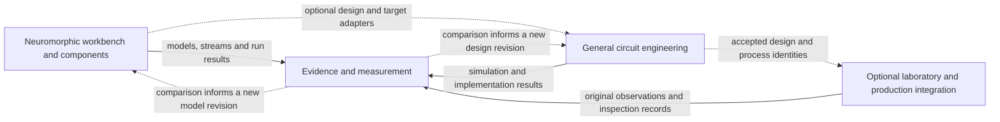
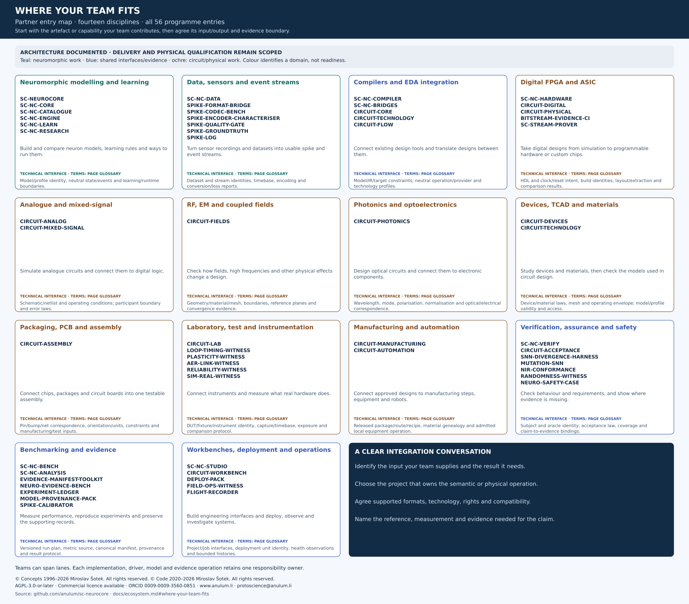

<!-- SPDX-License-Identifier: AGPL-3.0-or-later -->
<!-- Commercial license available -->
<!-- © Concepts 1996–2026 Miroslav Šotek. All rights reserved. -->
<!-- © Code 2020–2026 Miroslav Šotek. All rights reserved. -->
<!-- ORCID: 0009-0009-3560-0851 -->
<!-- Contact: www.anulum.li | protoscience@anulum.li -->
<!-- SC-NeuroCore — Group and project map -->

# Group and Project Map

## What this programme is for

This programme connects models of spiking neurons, circuit design and hardware
testing so teams can carry a design from an experiment to a result they can
check and reproduce. It serves researchers, software and circuit engineers,
measurement teams and collaborators assessing the work. SC-NeuroCore is the
existing software workbench; the smaller components, general circuit platform
and manufacturing integrations are at the stages shown below.

_Last reviewed: 2026-11-04. Status describes the documented delivery boundary,
not blanket qualification of every model, backend or physical target._

- **Use the workbench today**

    Start with [installation profiles](guides/install_profiles.md) and
    [getting started](guides/getting-started.md). The experimental visual
    interface has its own [Studio manual](studio/manual/index.md).

- **Find your team's entry point**

    Browse [disciplines and interfaces](#where-your-team-fits) or the
    [partner entry map](#partner-entry-map). Teams can contribute an adapter,
    a domain method, a design, a reference or a measurement capability.

- **Understand the architecture**

    Follow the [project catalogue](#programme-overview),
    [processes](#processes-and-interfaces) and
    [transition roadmap](#neuromorphic-transition-roadmap).

- **Read the evidence boundary**

    [Architecture and delivery](#how-to-read-status) are distinct.
    [Current project status](#what-exists-today) separates the workbench,
    scaffolds and unfinished implementations.

!!! info "Documented architecture, explicit delivery"

    Project summaries below describe their responsibility and main inputs and
    outputs. They are architectural interfaces, rather than released API names
    or a claim that every planned operation is implemented.

**SC-NeuroCore will remain a public, open-source development workbench** for the
**SC Neuromorphic Computing Systems** group. The group is building a connected
engineering workflow: develop models, compare their behaviour, implement them
on a selected target and trace measured results back to the original design.
The intended scope extends from neuromorphic software to general circuit
engineering and optional laboratory and production integration.

The programme has four connected parts. Each retains its own engineering
semantics, implementation status and evidence requirements.

| Programme line | Purpose and relationship |
| --- | --- |
| Neuromorphic workbench and components | The existing workbench brings simulation, learning, analysis, acceleration, compilation and experimental Studio workflows together. Thirteen planned SC-NC extractions would give these responsibilities focused releases and versioned interfaces. |
| Evidence and measurement | LOOP-TIMING-WITNESS and 25 supporting tools cover timing, data quality, numerical conformance, provenance, benchmarking, deployment and assurance. Shared records connect a claim to its actual source; they do not replace the domain or instrument checks. |
| General circuit engineering | Sixteen adopted destinations describe a platform for analogue, digital and mixed-signal designs, with specialist physical domains and technologies. Neuromorphic designs would be one application; the platform would also serve non-neural circuits. |
| Laboratory and production integration | Optional manufacturing and automation paths would connect design identities, approved processes, materials, equipment providers and measured hardware. Local controllers and manufacturing authorities retain their operational responsibilities. |

The split architecture is prepared. The current integrated package retains
its documented maturity; component releases and migration guides will accompany
the transition. General circuit and manufacturing capabilities described here
remain planned. See the repository releases for the current package version.

## How to read status

| Label | Meaning on this page |
| --- | --- |
| **Existing** | A current repository and usable package surface with its own documented maturity and supported workflows. |
| **Scaffold** | Repository and validation infrastructure exist; an installed domain runtime or released service is not established. |
| **Architecture stage** | Owned contracts and architecture-stage software or validation tooling exist; implementation and qualification remain scoped to their actual evidence. |
| **Architecture documented** | An owned written design and main interfaces exist. Implementation, independent qualification and release are separate milestones. |
| **Planned** | An adopted destination or extraction boundary; a separately released implementation is not announced. Current related work may still live in SC-NeuroCore. |

Architecture and delivery are separate axes. “Architecture documented” describes
the design; Existing, Scaffold, Architecture stage and Planned describe delivery.
These labels apply to the project destination. The “Where it lives today”
column links current source and documentation, rather than promising that every
listed module ships in the base wheel. Optional and source-only research paths
retain their [package boundaries](architecture/package_boundary_decision.md).
A documented architecture, valid manifest, simulation, synthesis report,
manufacturer acceptance and calibrated physical measurement establish different
facts. Domain laws, uncertainty and approval remain specific to the operation.

The maps share **56 entries: 1 workbench + 13 neuromorphic destinations +
26 measurement and evidence projects + 16 circuit destinations**. In the
catalogue, delivery is written on each card. In the circuit and lifecycle maps,
green denotes existing software, blue architecture-stage projects or adopted
direction, and dashed outlines planned implementation. Arrows in all four maps
show intended handoffs and responsibility, rather than package imports,
extraction order, released capability or physical operating permission.

## Where your team fits

Choose a discipline, identify the artefact your team produces or consumes, and
start with the corresponding project interfaces. A team may span several lanes;
shared participation preserves the single responsibility owner named in each
project summary. Source formats, numerical laws, technology access, instrument
calibration and local operating authority remain explicit at integration.
The [glossary](#abbreviations) explains the technical abbreviations used below;
each discipline starts with what its team would do in everyday engineering terms.

| Discipline | Projects your team touches | Contribute or consume | Interfaces to inspect first |
| --- | --- | --- | --- |
| Neuromorphic modelling and learning | [SC-NEUROCORE](#sc-neurocore), [SC-NC-CORE](#sc-nc-core), [SC-NC-CATALOGUE](#sc-nc-catalogue), [SC-NC-ENGINE](#sc-nc-engine), [SC-NC-LEARN](#sc-nc-learn), [SC-NC-RESEARCH](#sc-nc-research) | Build and compare neuron models, learning rules and ways to run them. Contribute model semantics, learning methods or runtime capabilities; consume explicit state and numerical contracts. | Model/profile identity, neutral state/events and learning/runtime boundaries. |
| Data, sensors and event streams | [SC-NC-DATA](#sc-nc-data), [SPIKE-FORMAT-BRIDGE](#spike-format-bridge), [SPIKE-CODEC-BENCH](#spike-codec-bench), [SPIKE-ENCODER-CHARACTERISER](#spike-encoder-characteriser), [SPIKE-QUALITY-GATE](#spike-quality-gate), [SPIKE-GROUNDTRUTH](#spike-groundtruth), [SPIKE-LOG](#spike-log) | Turn sensor recordings and datasets into usable spike and event streams. Contribute encoders, readers, datasets or data-quality methods; consume identified streams with declared loss. | Dataset and stream identities, timebase, encoding and conversion/loss reports. |
| Compilers and electronic design automation (EDA) | [SC-NC-COMPILER](#sc-nc-compiler), [SC-NC-BRIDGES](#sc-nc-bridges), [CIRCUIT-CORE](#circuit-core), [CIRCUIT-TECHNOLOGY](#circuit-technology), [CIRCUIT-FLOW](#circuit-flow) | Connect existing design tools and translate designs between them. Contribute compiler passes or tool adapters; consume typed design views and admitted execution interfaces. | Model/IR/target constraints; neutral operation/provider and technology profiles. |
| Digital programmable logic (FPGA) and custom chips (ASIC) | [SC-NC-HARDWARE](#sc-nc-hardware), [CIRCUIT-DIGITAL](#circuit-digital), [CIRCUIT-PHYSICAL](#circuit-physical), [BITSTREAM-EVIDENCE-CI](#bitstream-evidence-ci), [SC-STREAM-PROVER](#sc-stream-prover) | Take digital designs from simulation to programmable hardware or custom chips. Contribute RTL, constraints, digital validation or target integration; consume traceable implementation artefacts. | HDL and clock/reset intent, build identities, layout/extraction and comparison results. |
| Analogue and mixed-signal | [CIRCUIT-ANALOG](#circuit-analog), [CIRCUIT-MIXED-SIGNAL](#circuit-mixed-signal) | Simulate analogue circuits and connect them to digital logic. Contribute device-model integration, circuit studies or continuous/discrete coupling; consume scoped simulation results. | Schematic/netlist and operating conditions; participant boundary and error laws. |
| Radio frequency (RF), electromagnetics (EM) and coupled fields | [CIRCUIT-FIELDS](#circuit-fields) | Check how fields, high frequencies and other physical effects change a design. Contribute electromagnetic or coupled-field operations; consume declared port or reduced-model results. | Geometry/material/mesh, boundaries, reference planes and convergence evidence. |
| Photonics and optoelectronics | [CIRCUIT-PHOTONICS](#circuit-photonics) | Design optical circuits and connect them to electronic components. Contribute optical models, layout integration or electrical coupling; consume technology-specific optical views. | Wavelength, mode, polarisation, normalisation and optical/electrical correspondence. |
| Devices, device/process simulation (TCAD) and materials | [CIRCUIT-DEVICES](#circuit-devices), [CIRCUIT-TECHNOLOGY](#circuit-technology) | Study devices and materials, then check the models used in circuit design. Contribute device/process studies, material profiles or compact-model validation; consume explicit applicability limits. | Device/material laws, mesh and operating envelope; model/profile validity and access. |
| Packaging, printed circuit boards (PCB) and assembly | [CIRCUIT-ASSEMBLY](#circuit-assembly) | Connect chips, packages and circuit boards into one testable assembly. Contribute die/package/board interfaces, stackups or test-fixture integration; consume consistent assembly deliverables. | Pin/bump/net correspondence, orientation/units, constraints and manufacturing/test inputs. |
| Laboratory, test and instrumentation | [CIRCUIT-LAB](#circuit-lab), [LOOP-TIMING-WITNESS](#loop-timing-witness), [PLASTICITY-WITNESS](#plasticity-witness), [AER-LINK-WITNESS](#aer-link-witness), [RELIABILITY-WITNESS](#reliability-witness), [SIM-REAL-WITNESS](#sim-real-witness) | Connect instruments and measure what real hardware does. Contribute instrument adapters, measurement methods or independently supported calibration; consume original captures and uncertainty. | Device under test (DUT), fixture and instrument identity; capture/timebase, exposure and comparison protocol. |
| Manufacturing and automation | [CIRCUIT-MANUFACTURING](#circuit-manufacturing), [CIRCUIT-AUTOMATION](#circuit-automation) | Connect approved designs to manufacturing steps, equipment and robots. Contribute supplier/MES/equipment adapters and process qualification; consume approved routes and original execution observations. | Released package/route/recipe, material genealogy and admitted local equipment operation. |
| Verification, assurance and safety | [SC-NC-VERIFY](#sc-nc-verify), [CIRCUIT-ACCEPTANCE](#circuit-acceptance), [SNN-DIVERGENCE-HARNESS](#snn-divergence-harness), [MUTATION-SNN](#mutation-snn), [NIR-CONFORMANCE](#nir-conformance), [RANDOMNESS-WITNESS](#randomness-witness), [NEURO-SAFETY-CASE](#neuro-safety-case) | Check behaviour and requirements, and show where evidence is missing. Contribute independent references, comparison laws or assurance arguments; consume attributable results and visible gaps. | Subject and oracle identity, acceptance law, coverage and claim-to-evidence bindings. |
| Benchmarking and evidence | [SC-NC-BENCH](#sc-nc-bench), [SC-NC-ANALYSIS](#sc-nc-analysis), [EVIDENCE-MANIFEST-TOOLKIT](#evidence-manifest-toolkit), [NEURO-EVIDENCE-BENCH](#neuro-evidence-bench), [EXPERIMENT-LEDGER](#experiment-ledger), [MODEL-PROVENANCE-PACK](#model-provenance-pack), [SPIKE-CALIBRATOR](#spike-calibrator) | Measure performance, reproduce experiments and preserve the supporting records. Contribute workloads, statistics or reproducibility methods; consume evidence-bound results and model/experiment lineage. | Versioned run plan, metric source, canonical manifest, provenance and result protocol. |
| Workbenches, deployment and operations | [SC-NC-STUDIO](#sc-nc-studio), [CIRCUIT-WORKBENCH](#circuit-workbench), [DEPLOY-PACK](#deploy-pack), [FIELD-OPS-WITNESS](#field-ops-witness), [FLIGHT-RECORDER](#flight-recorder) | Build engineering interfaces and deploy, observe and investigate systems. Contribute accessible engineering UI, deployment integration or incident workflows; consume existing headless operations and evidence. | Project/job interfaces, deployment unit identity, health observations and bounded histories. |

### Presentation and print

The detailed maps preserve the complete catalogue. These 16:9 figures provide
larger text for presenting the process and discipline entry points:

- [Engineering chain — PNG](assets/sc_neurocore_process_slide.png)
  ([SVG](assets/sc_neurocore_process_slide.svg)).
- [Models, data, compilers and digital design — PNG](assets/sc_neurocore_partner_modelling_slide.png)
  ([SVG](assets/sc_neurocore_partner_modelling_slide.svg)).
- [Analogue, fields, photonics, devices and assembly — PNG](assets/sc_neurocore_partner_physical_slide.png)
  ([SVG](assets/sc_neurocore_partner_physical_slide.svg)).
- [Laboratory, manufacturing, assurance, evidence and operations — PNG](assets/sc_neurocore_partner_integration_slide.png)
  ([SVG](assets/sc_neurocore_partner_integration_slide.svg)).

[Open the print-friendly page](assets/sc_neurocore_ecosystem_print.html) for a
standalone reading and browser-print version with the same project summaries.

## Programme overview

[Open the full-size SVG](assets/sc_neurocore_group_map.svg),
[download PNG](assets/sc_neurocore_group_map.png), or
[download JPG](assets/sc_neurocore_group_map.jpg).

Browse the catalogue by responsibility:
[neuromorphic components](#specialized-repositories),
[measurement and evidence tools](#supporting-tools), or
[general circuit destinations](#planned-platform-repositories).
The companion views explain the process interfaces, circuit family and lifecycle.

## Processes and interfaces

[Open the process and interface SVG](assets/sc_neurocore_process_map.svg),
[download PNG](assets/sc_neurocore_process_map.png), or
[download JPG](assets/sc_neurocore_process_map.jpg).
Follow the [integration contracts](#integration-model),
[measurement responsibilities](#supporting-tools) and
[production path](#manufacturing-and-laboratory-automation) in the text.

This companion view places all 56 entries in their intended engineering flows.
Each operation can reject unsupported inputs and returns attributable results.

Neuromorphic models and streams lead through execution, learning, lowering and
checks to target observations and analysis. Optional compiler and hardware
adapters hand explicit design views to general circuit operations. Circuit
engineering retains its own models, technology profiles and acceptance laws;
existing schematics, RTL, netlists or layouts may enter at the appropriate stage.
The diagram's left-to-right order does not require fabrication for every design.

Input, numerical, hardware and field tools contribute evidence at their relevant
stages. Shared manifests and experiment lineage preserve the source and conditions
of each result. SC-NC-BENCH owns neuromorphic workloads; NEURO-EVIDENCE-BENCH
provides a shared execution and result protocol. CIRCUIT-ACCEPTANCE aggregates
circuit requirement results without replacing domain checks or human approval.

The optional production branch binds accepted design and process identities to
supplier handoff or admitted local equipment. Original material, inspection and
measurement records return through laboratory and evidence contracts. Failures,
measured divergence and field incidents inform a new revision of the owning
design or model; they do not overwrite its original results. Qualified local
controllers and site authorities retain physical timing and protective control.

### Programme connections

The diagram summarises the four programme lines. Detailed project ownership
appears in the tables and full-size maps; physical control remains with the
qualified local controller and site authority.

### Partner entry map

[Open the partner entry SVG](assets/sc_neurocore_partner_entry_map.svg),
[download PNG](assets/sc_neurocore_partner_entry_map.png), or
[download JPG](assets/sc_neurocore_partner_entry_map.jpg).
Use the [discipline matrix](#where-your-team-fits) for direct project links and
[project summaries](#specialized-repositories) for exact ownership boundaries.

## Public workbench and future products

SC-NeuroCore keeps its public workbench role and current open-source licence.
Future specialised components may become open-source or proprietary products.
Their licensing and commercial boundaries remain under discussion with investors
and IP partners and will be announced individually. Several supporting tools
will remain public, with their own documented licensing and release status.

## What exists today

| Repository | Function | Current status |
| --- | --- | --- |
| [SC-NEUROCORE](https://github.com/anulum/sc-neurocore) | Integrated development workbench: simulation, learning, analysis, acceleration, compilation, hardware-oriented evidence and the experimental visual Studio (<code style="white-space: nowrap">sc-neurocore[studio]</code>). **Interfaces:** Model, data and workflow configuration → simulation, analysis and implementation artefacts with scoped evidence. | **Existing** · architecture documented — repository and Python package; package metadata remains at beta maturity. Individual capabilities have their own evidence boundaries. |
| [LOOP-TIMING-WITNESS](https://github.com/anulum/loop-timing-witness) | Timing instrument for loop and accelerator latency, jitter, deadlines, fault response and energy measurements. | **Architecture stage** — software/native/RTL simulation and measurement contracts. Physical board qualification remains pending. |
| EVIDENCE-MANIFEST-TOOLKIT | Portable evidence-manifest contracts and validation infrastructure. | **Scaffold** — architecture-stage repository with local checks. No released signing, verification or domain runtime package. |
| NEURO-EVIDENCE-BENCH | Auditable benchmark plans, evidence-backed results and independent reruns. | **Architecture stage** — repository with validation tooling; benchmark execution, metric collection and comparison remain under implementation. No released benchmark runtime. |

## Why split the workbench

A modeller should be able to work with neuron primitives and analysis without
installing an FPGA toolchain. A hardware engineer should find compilation and
target integration together. A team checking results should be able to use an
evidence tool through a documented contract. Focused repositories make these
entry points easier to understand and maintain.

SC-NeuroCore keeps its role as the place to develop and integrate the complete
workflow. It will continue to support experiments spanning several components
and provide a practical route through the group. Specialised repositories will
own their implementations and public interfaces; shared functionality should
be consumed through those interfaces rather than copied between repositories.

## Specialised repositories

All 13 repositories in this section are planned extraction destinations.
Their summaries describe documented ownership and intended interfaces. The
current implementations remain in the workbench until the transition gates pass.

### Foundation and execution

| Destination | Responsibility | Status | Where it lives today |
| --- | --- | --- | --- |
| **SC-NC-CORE** | Neutral population, graph, state, event, seed and numerical protocols. Concrete model selection stays with the catalogue or compatibility facade. **Interfaces:** Resolved model factories and numerical/state contracts → neutral populations, graphs, state and events. | **Architecture documented** · extraction planned | [neurons](https://github.com/anulum/sc-neurocore/tree/main/src/sc_neurocore/neurons); [synapses](https://github.com/anulum/sc-neurocore/tree/main/src/sc_neurocore/synapses); [network](https://github.com/anulum/sc-neurocore/tree/main/src/sc_neurocore/network). [Neuron APIs](api/neurons.md). |
| **SC-NC-CATALOGUE** | Canonical model identities, authored equations and profiles, declarations and model factories, with provenance and compatibility preserved. **Interfaces:** Authored equations, profiles and provenance → identified models, declarations and resolved factories. | **Architecture documented** · extraction planned | [neuron models](https://github.com/anulum/sc-neurocore/tree/main/src/sc_neurocore/neurons/models); [model_zoo](https://github.com/anulum/sc-neurocore/tree/main/src/sc_neurocore/model_zoo); [network topology](https://github.com/anulum/sc-neurocore/blob/main/src/sc_neurocore/network/topology.py). [Model zoo](api/model_zoo.md). |
| **SC-NC-ENGINE** | Execution, scheduling and native-runtime boundaries, including supported state, update and restore contracts; model semantics remain catalogue-owned. **Interfaces:** Admitted model/runtime contracts and commands → execution state, events and attributable observations. | **Architecture documented** · extraction planned | [accel](https://github.com/anulum/sc-neurocore/tree/main/src/sc_neurocore/accel); [Rust engine](https://github.com/anulum/sc-neurocore/tree/main/engine/src); [MPI runner](https://github.com/anulum/sc-neurocore/blob/main/src/sc_neurocore/network/mpi_runner.py). [Acceleration boundaries](api/accel.md). |
| **SC-NC-BRIDGES** | Directional interchange and external-provider adapters with declared transformation assumptions and losses; model equations and lowering retain their owners. **Interfaces:** External models, formats or provider requests → typed representations or results with explicit changes and losses. | **Architecture documented** · extraction planned | [nir_bridge](https://github.com/anulum/sc-neurocore/tree/main/src/sc_neurocore/nir_bridge); [adapters](https://github.com/anulum/sc-neurocore/tree/main/src/sc_neurocore/adapters); [bridges](https://github.com/anulum/sc-neurocore/tree/main/src/sc_neurocore/bridges); [quantum](https://github.com/anulum/sc-neurocore/tree/main/src/sc_neurocore/quantum); [hdc](https://github.com/anulum/sc-neurocore/tree/main/src/sc_neurocore/hdc); [neuro_symbolic](https://github.com/anulum/sc-neurocore/tree/main/src/sc_neurocore/neuro_symbolic). [NIR integration](guides/nir_integration.md). Speculative bridges retain research status. |

### Learning and data

| Destination | Responsibility | Status | Where it lives today |
| --- | --- | --- | --- |
| **SC-NC-LEARN** | Training orchestration, learning rules and optimiser state, quantisation-aware objectives and distillation through explicit model/runtime contracts. **Interfaces:** Model, data, learning rule and optimiser configuration → learned parameters, learning state and provenance. | **Architecture documented** · extraction planned | [learning](https://github.com/anulum/sc-neurocore/tree/main/src/sc_neurocore/learning); [training](https://github.com/anulum/sc-neurocore/tree/main/src/sc_neurocore/training); [synaptic plasticity](https://github.com/anulum/sc-neurocore/tree/main/src/sc_neurocore/synapses); [qat](https://github.com/anulum/sc-neurocore/tree/main/src/sc_neurocore/qat); [distillation](https://github.com/anulum/sc-neurocore/tree/main/src/sc_neurocore/distillation). [Learning APIs](api/learning.md). |
| **SC-NC-DATA** | Datasets, event and spike encodings, codecs, sources and recorders. **Interfaces:** Digital samples, datasets and accepted state payloads → typed streams, encodings and checkpoint records. | **Architecture documented** · extraction planned | [datasets](https://github.com/anulum/sc-neurocore/tree/main/src/sc_neurocore/datasets); [encoding](https://github.com/anulum/sc-neurocore/tree/main/src/sc_neurocore/encoding); [recorders](https://github.com/anulum/sc-neurocore/tree/main/src/sc_neurocore/recorders); [spike_codec](https://github.com/anulum/sc-neurocore/tree/main/src/sc_neurocore/spike_codec); [sources](https://github.com/anulum/sc-neurocore/tree/main/src/sc_neurocore/sources). [Dataset contracts](api/datasets.md). |
| **SC-NC-ANALYSIS** | Derived observables, statistical interpretation and visual views over identified traces; runtime collection stays with the producer. **Interfaces:** Identified traces, events and comparison results → derived observables, validity information and views. | **Architecture documented** · extraction planned | [analysis](https://github.com/anulum/sc-neurocore/tree/main/src/sc_neurocore/analysis); [viz](https://github.com/anulum/sc-neurocore/tree/main/src/sc_neurocore/viz). [Analysis reference](api/analysis.md). Source-only areas excluded from the base wheel. |

### Silicon and verification

| Destination | Responsibility | Status | Where it lives today |
| --- | --- | --- | --- |
| **SC-NC-COMPILER** | Intermediate representations to RTL/Verilog, co-simulation, equivalence and ASIC export. **Interfaces:** Model/profile, typed intermediate representation and target constraints → generated source and bound artefact bundles. | **Architecture documented** · extraction planned | [compiler](https://github.com/anulum/sc-neurocore/tree/main/src/sc_neurocore/compiler); [ir](https://github.com/anulum/sc-neurocore/tree/main/src/sc_neurocore/ir). [Compiler APIs](api/compiler.md). |
| **SC-NC-HARDWARE** | Target profiles, mapping, adapters, drivers and physical deployment models. **Interfaces:** Target facts, generated artefacts and admitted commands → device integration and original acquisition observations. | **Architecture documented** · extraction planned | [hardware](https://github.com/anulum/sc-neurocore/tree/main/src/sc_neurocore/hardware); [target profiles](https://github.com/anulum/sc-neurocore/tree/main/src/sc_neurocore/compiler/platforms); [source-only drivers](https://github.com/anulum/sc-neurocore/tree/main/src/sc_neurocore/drivers). [Hardware abstraction](api/hardware.md). |
| **SC-NC-VERIFY** | Formal checks, fault injection, resilience and verification. **Interfaces:** Bound subject, comparison law and independent reference → scoped findings, conformance or inconclusive results. | **Architecture documented** · extraction planned | [verification](https://github.com/anulum/sc-neurocore/tree/main/src/sc_neurocore/verification); [formal](https://github.com/anulum/sc-neurocore/tree/main/src/sc_neurocore/formal); [fault_injection](https://github.com/anulum/sc-neurocore/tree/main/src/sc_neurocore/fault_injection). [Verification contracts](api/verification.md). |

### Workspace and research

| Destination | Responsibility | Status | Where it lives today |
| --- | --- | --- | --- |
| **SC-NC-STUDIO** | Visual IDE, integration workflows and evidence presentation. **Interfaces:** User projects and public operation requests → observed jobs, design views, replay and evidence presentation. | **Architecture documented** · extraction planned | [Studio backend](https://github.com/anulum/sc-neurocore/tree/main/src/sc_neurocore/studio); [frontend](https://github.com/anulum/sc-neurocore/tree/main/studio/frontend). [Studio preview](studio/index.md). |
| **SC-NC-RESEARCH** | Named hypotheses, contextual experiments and research workloads with explicit source, purpose, uncertainty and disposition. **Interfaces:** Named hypotheses, source models and experimental context → attributable experiments and explicit limitations. | **Architecture documented** · extraction planned | Not yet consolidated. [opt-in experiments](https://github.com/anulum/sc-neurocore/tree/main/src/sc_neurocore/experimental); [source-only research](https://github.com/anulum/sc-neurocore/tree/main/research). [Research boundaries](api/research-speculative.md). |
| **SC-NC-BENCH** | Versioned neuromorphic workloads and public-runtime comparison adapters; shared evidence execution protocols remain separately owned. **Interfaces:** Versioned workloads, public runtime adapters and comparison conditions → benchmark observations and reproducibility records. | **Architecture documented** · extraction planned | [benchmark APIs](https://github.com/anulum/sc-neurocore/tree/main/src/sc_neurocore/benchmarks); [workloads and results](https://github.com/anulum/sc-neurocore/tree/main/benchmarks). [Benchmark evidence](api/benchmarks.md). |

## Supporting tools

These 26 measurement and evidence projects comprise LOOP-TIMING-WITNESS and
25 supporting tools. They serve the group through explicit data,
measurement and evidence contracts. They complement the SC-NC components and
have separate responsibilities. EVIDENCE-MANIFEST-TOOLKIT has the scaffold
status described above. NEURO-EVIDENCE-BENCH also has architecture-stage
validation tooling. LOOP-TIMING-WITNESS has software/native/RTL measurement
contracts; physical board qualification remains pending. The other tools below
are planned.

### Evidence and lineage

| Project | Responsibility | Status |
| --- | --- | --- |
| **EVIDENCE-MANIFEST-TOOLKIT** | Shared evidence schemas, canonical bytes, hashing, sealing, signatures and validation. **Interfaces:** Artefacts, schema/profile identities and trust policy → canonical manifests, seals and scoped verification outcomes. | **Architecture documented** · scaffold; domain runtime open |
| **MODEL-PROVENANCE-PACK** | Training, conversion and quantisation provenance tied to evidence. **Interfaces:** Model, training and conversion lineage plus evidence references → policy-checkable provenance packs. | **Architecture documented** · implementation planned |
| **EXPERIMENT-LEDGER** | Queryable experiment configurations and evidence lineage. **Interfaces:** Versioned configurations and artefact references → queryable experiment history and lineage reports. | **Architecture documented** · implementation planned |
| **SPIKE-LOG** | Event-stream containers, integrity checks and replay. **Interfaces:** Captured events and declared timebase → integrity-checked containers, slices and logical replay. | **Architecture documented** · implementation planned |

### Data and encoders

| Project | Responsibility | Status |
| --- | --- | --- |
| **SPIKE-FORMAT-BRIDGE** | Event-format conversion with round-trip and loss evidence. **Interfaces:** Source event files/streams and conversion settings → target formats, correspondence and loss reports. | **Architecture documented** · implementation planned |
| **SPIKE-CODEC-BENCH** | Compression ratio, distortion and computational cost measurements. **Interfaces:** Identified datasets, codec adapters and declared metrics → compression, distortion, runtime and memory results. | **Architecture documented** · implementation planned |
| **SPIKE-ENCODER-CHARACTERISER** | Sensor-to-spike quality, rate and latency characterisation. **Interfaces:** Continuous-valued stimuli and encoder settings → spikes and measured quality/rate/latency trade-offs. | **Architecture documented** · implementation planned |
| **SPIKE-QUALITY-GATE** | Versioned event-data quality policies and reports. **Interfaces:** Event streams, conversion context and versioned policy → located quality measurements and policy verdicts. | **Architecture documented** · implementation planned |
| **SPIKE-GROUNDTRUTH** | Reproducible, labelled and sealed stimulus streams. **Interfaces:** Generator identity, parameters and seeds → reproducible stimulus streams, labels and provenance. | **Architecture documented** · implementation planned |

### Numerical behaviour and conformance

| Project | Responsibility | Status |
| --- | --- | --- |
| **SNN-DIVERGENCE-HARNESS** | Cross-runtime SNN comparisons against declared numerical oracles. **Interfaces:** Network/input specification, backend adapters and declared oracle → comparison outcomes and reproducing counterexamples where found. | **Architecture documented** · implementation planned |
| **SC-STREAM-PROVER** | Realised stochastic arithmetic errors compared with declared bounds. **Interfaces:** Arithmetic experiment, stream sources and error budget → realised error, bound comparisons and stream-length results. | **Architecture documented** · implementation planned |
| **RANDOMNESS-WITNESS** | Random and low-discrepancy source qualification for a declared use. **Interfaces:** Source identity, captured streams and intended use → source/capture-specific statistical qualification reports. | **Architecture documented** · implementation planned |
| **MUTATION-SNN** | SNN-specific mutation testing to assess test-suite adequacy. **Interfaces:** Model, passing baseline suite and mutation operators → classified mutant outcomes and test-adequacy findings. | **Architecture documented** · implementation planned |
| **NIR-CONFORMANCE** | Independent checks of versioned NIR import/export semantics. **Interfaces:** Versioned NIR semantics, reference graphs and import/export adapters → per-primitive conformance outcomes. | **Architecture documented** · implementation planned |
| **NEURO-EVIDENCE-BENCH** | Shared benchmark-plan execution and verifiable result contracts. **Interfaces:** Sealed benchmark plan and admitted execution/instrument providers → evidence-bound results and comparisons. | **Architecture documented** · validation tooling; runtime in development |
| **SPIKE-CALIBRATOR** | Classifier-confidence calibration and deployment-placement drift. **Interfaces:** Model, datasets, confidence definition and shift protocol → classifier-calibration and placement-drift reports. | **Architecture documented** · implementation planned |

### Hardware measurements

| Project | Responsibility | Status |
| --- | --- | --- |
| **LOOP-TIMING-WITNESS** | Timing instrument for loop and accelerator latency, jitter, deadlines, fault response and energy measurements. **Interfaces:** Loop/accelerator profile, original event captures and instrument context → timing, deadline and fault-response evidence; energy uses its own measurement source. | **Architecture documented** · physical qualification open |
| **BITSTREAM-EVIDENCE-CI** | Reproducible FPGA build inputs, toolchain and bitstream evidence. **Interfaces:** Pinned HDL, constraints, tools and build conditions → original build outputs and reproducibility evidence. | **Architecture documented** · implementation planned |
| **PLASTICITY-WITNESS** | Measured physical learning-rule updates compared with fixed-point oracles. **Interfaces:** Learning-rule protocol, physical update captures and independent oracle → update-level or declared distributional comparisons. | **Architecture documented** · implementation planned |
| **AER-LINK-WITNESS** | Address-event link throughput, loss, reordering and starvation. **Interfaces:** Traffic patterns, link/router under test and original event captures → throughput, loss, ordering and service-delay results. | **Architecture documented** · implementation planned |
| **RELIABILITY-WITNESS** | Observed fabric errors and drift within declared exposure limits. **Interfaces:** Identified workloads, valid exposure and observed conditions/events → error-rate bounds and drift reports. | **Architecture documented** · implementation planned |
| **SIM-REAL-WITNESS** | Simulation-to-fabric divergence for a declared implementation pair. **Interfaces:** Matched network/input identities and simulation/fabric observations → scoped divergence and budget comparisons. | **Architecture documented** · implementation planned |

### Deployment and assurance

| Project | Responsibility | Status |
| --- | --- | --- |
| **DEPLOY-PACK** | Installable deployment units bound to their supporting evidence. **Interfaces:** Target artefacts, provenance and policy-required evidence → verifiable deployment units and installation/update records. | **Architecture documented** · implementation planned |
| **FIELD-OPS-WITNESS** | Deployment health, drift, timing and coverage against baselines. **Interfaces:** Unit identity, deployment envelope and observed telemetry → health/drift findings with coverage and gaps explicit. | **Architecture documented** · implementation planned |
| **FLIGHT-RECORDER** | Bounded on-unit event and state histories for incident investigation. **Interfaces:** Declared on-unit capture scope and event/state observations → bounded histories and gap-aware incident reconstruction. | **Architecture documented** · implementation planned |
| **NEURO-SAFETY-CASE** | Scoped assurance arguments and explicit evidence gaps for human assessment. **Interfaces:** Claim structure and evidence bindings → visible assurance gaps and assessor-oriented exports for human review. | **Architecture documented** · implementation planned |

SC-NC-BENCH owns workload-specific benchmark suites and their run evidence.
NEURO-EVIDENCE-BENCH provides the shared plan-execution and result protocol that
those suites and Studio can consume. LOOP-TIMING-WITNESS measures timing;
AER-LINK-WITNESS assesses event-link behaviour. These boundaries keep domain
workloads, shared tooling and physical measurements distinct.

## General circuit-design platform

The group is designing a general platform connecting circuit specifications,
simulation, implementation, physical design, assembly and measured hardware.
It is intended for analogue, digital and mixed-signal designs from the beginning,
with explicit extension points for other physical domains and technologies.
SC-NeuroCore would be one application of that platform; the general platform
would be usable without neuron models or an SNN runtime.

The sixteen names below are adopted destinations for the new family. Actual
tool, process, device and manufacturing support is qualified per operation and
published with its limitations. No tapeout or manufacturing schedule is announced.

### Coverage and separate semantics

| Design family | Intended scope and distinct requirements |
| --- | --- |
| Digital | Synchronous and asynchronous logic, control, processors, accelerators and memories; FPGA and ASIC implementations, clocks/reset, equivalence, timing and testability. |
| Analogue | Signal conditioning, references, filters, oscillators, sensors and power circuits; continuous device behaviour, stability, noise, variability and operating limits. |
| Mixed-signal | Data converters, timing circuits, sensor interfaces and digitally assisted analogue; explicit sampling, thresholds, event timing and continuous/discrete coupling. |
| RF and coupled fields | RF/microwave structures, signal/power integrity and electrothermal or electromechanical effects; specialised models, geometry, meshes and boundary conditions. |
| Photonic and optoelectronic | Optical circuit/layout models and electrical coupling, with wavelength, mode, polarisation and optical-loss semantics. |
| Device and specialist technologies | Process/device modelling, specialised memories, MEMS and research extensions such as cryogenic circuits, each with its own supported models and validation. |
| Assembly and boards | Die/package/interposer/PCB interfaces, discrete components, heterogeneous chiplets and stacked systems, test fixtures and bring-up. |

Technology profiles would distinguish silicon CMOS/SOI and device families,
SiGe/BiCMOS and high-voltage processes, compound or wide-bandgap materials such
as GaAs, InP, GaN and SiC, optical platforms and specialised functional materials.
Material, substrate, device, process, layout stack and package are separate
attributes. Adding one profile would not imply support for every design or
operation using that material. Emerging or research models would retain their
research status.

### Planned platform repositories

| Destination | Responsibility | Status |
| --- | --- | --- |
| **CIRCUIT-CORE** | Neutral design hierarchy, ports, units, parameters, view correspondence and operation contracts. **Interfaces:** Native design views, hierarchy, units and capability descriptions → typed identities, correspondence and operation contracts. | **Architecture documented** · implementation planned |
| **CIRCUIT-TECHNOLOGY** | Identified PDK, device, library, verification-deck and assembly profiles with tool compatibility and applicability. **Interfaces:** Identified PDKs, models, libraries, decks and access conditions → applicable technology/tool profiles. | **Architecture documented** · implementation planned |
| **CIRCUIT-FLOW** | Reproducible circuit workflows, admitted tool dispatch, artefact propagation and recovery. **Interfaces:** Operation graph, admitted providers and input/profile identities → traceable execution, outputs and recovery state. | **Architecture documented** · implementation planned |
| **CIRCUIT-DIGITAL** | Digital simulation, formal/synthesis and implementation adapters, timing and testability intent. **Interfaces:** HDL, elaboration/stimulus parameters and clock/reset constraints → digital simulation, formal or synthesis artefacts. | **Architecture documented** · implementation planned |
| **CIRCUIT-ANALOG** | Circuit/schematic and device-model integration, analogue simulation, sizing and layout constraints. **Interfaces:** Schematic/netlist, compact models and operating/study conditions → raw circuit results, convergence and specification comparisons. | **Architecture documented** · implementation planned |
| **CIRCUIT-MIXED-SIGNAL** | Boundary models and co-simulation integration for continuous and discrete participants. **Interfaces:** Continuous/discrete participant views and explicit coupling laws → coordinated results and cross-domain discrepancy evidence. | **Architecture documented** · implementation planned |
| **CIRCUIT-PHYSICAL** | Layout implementation and interchange, extraction and technology-specific physical-check integration. **Interfaces:** Design/layout correspondence, technology decks and constraints → layout, extraction and physical-check results. | **Architecture documented** · implementation planned |
| **CIRCUIT-ASSEMBLY** | Die, package, interposer, board and test-fixture integration. **Interfaces:** Die/package/board views, pin/net correspondence and constraints → assembly, manufacturing and test-fixture deliverables. | **Architecture documented** · implementation planned |
| **CIRCUIT-ACCEPTANCE** | Requirement-specific checks, comparison laws, coverage and scoped acceptance. **Interfaces:** Requirements, declared laws and actual domain results → scoped coverage and acceptance reports. | **Architecture documented** · implementation planned |
| **CIRCUIT-LAB** | Hardware bring-up, instrument integration and traceable characterisation. **Interfaces:** DUT, fixture, method, instrument/calibration and authority → original measurement captures with conditions and uncertainty. | **Architecture documented** · implementation planned |
| **CIRCUIT-WORKBENCH** | General design and review workspace using the same headless operations as the library and command-line clients. **Interfaces:** Projects, design views and authorised user actions → headless operation requests and accessible engineering review. | **Architecture documented** · implementation planned |
| **CIRCUIT-MANUFACTURING** | Versioned routes and recipes, material genealogy, work-order and inspection integration, and controlled supplier handoff. **Interfaces:** Accepted packages, approved routes/recipes and material identities → work-order, genealogy, inspection and supplier-handoff records. | **Architecture documented** · implementation planned |
| **CIRCUIT-AUTOMATION** | Admitted equipment capabilities and local execution-provider adapters for instruments, cells and robot tasks. **Interfaces:** Equipment capabilities, local authority and bounded admitted requests → native execution observations and reconciled outcomes. | **Architecture documented** · implementation planned |
| **CIRCUIT-FIELDS** | Electromagnetic and coupled-field operations, with specialised geometry, meshes and boundary conditions. **Interfaces:** Geometry, materials, mesh, boundaries and excitation → field/port results and declared reduced-model validity. | **Architecture documented** · implementation planned |
| **CIRCUIT-PHOTONICS** | Optical design semantics, including wavelength, mode, polarisation, loss and electrical coupling. **Interfaces:** Optical views, technology and wavelength/mode conventions → optical results and electrical/layout correspondence. | **Architecture documented** · implementation planned |
| **CIRCUIT-DEVICES** | Device/TCAD and compact-model work, with process-specific validation. **Interfaces:** Device geometry, material laws, solver controls and reference data → device studies and validated compact-model candidates. | **Architecture documented** · implementation planned |

The three specialist destinations have independent repository boundaries only
when actual supported use cases, maintainers and release ownership justify them. A distinct material, node or adapter does not automatically require
another repository. Every destination follows a module-first implementation
decision; shared foundation packages may initially live in one workspace.
Separate repositories require independent consumers, lifecycle and maintainers. CIRCUIT-ACCEPTANCE aggregates requirement
results; SC-NC-VERIFY retains SNN fidelity and digital formal operations remain
with their actual tool owners.

[Open the circuit-platform SVG](assets/sc_neurocore_circuit_platform_map.svg),
[download PNG](assets/sc_neurocore_circuit_platform_map.png), or
[download JPG](assets/sc_neurocore_circuit_platform_map.jpg).
Browse [all circuit destinations](#planned-platform-repositories) and their
[separate design semantics](#coverage-and-separate-semantics).
The destinations share design and technology contracts while retaining
separate domain models and acceptance rules. Their grouping does not commit to extracting sixteen repositories at once.

### Integration model

[Open the lifecycle SVG](assets/sc_neurocore_design_lifecycle.svg),
[download PNG](assets/sc_neurocore_design_lifecycle.png), or
[download JPG](assets/sc_neurocore_design_lifecycle.jpg).
Read the [integration model](#integration-model),
[production responsibilities](#manufacturing-and-laboratory-automation) and
[acceptance milestones](#development-roadmap).

The arrows describe an intended lifecycle. Individual views and operations keep
their own semantics and entry points; an existing RTL, schematic, netlist or
layout can enter at the appropriate stage. Iterations produce versioned successor
designs and preserve their original inputs and results.

The first integration route uses existing open-source tools. Candidates include
[Yosys/OpenROAD/KLayout through OpenROAD-flow-scripts](https://github.com/The-OpenROAD-Project/OpenROAD-flow-scripts),
[xschem](https://xschem.sourceforge.io/stefan/xschem_man/netlisting.html),
[ngspice with supported compact models and digital co-simulation](https://ngspice.sourceforge.io/extras.html),
and [KiCad](https://docs.kicad.org/) for board integration. Specialist tools and
commercial flows would be admitted through explicit tool/technology contracts.
Existing workflow and representation infrastructure, including
[SiliconCompiler](https://docs.siliconcompiler.com/en/latest/),
[LibreLane](https://librelane.readthedocs.io/en/stable/) and
[CIRCT](https://circt.llvm.org/), would be evaluated before building equivalent
functionality. Relevant [Accellera interface and verification standards](https://www.accellera.org/downloads/standards)
would inform supported interchange contracts. Own tools would address
demonstrated integration or engineering requirements.
PDK and IP access, applicable licences and manufacturer requirements remain
specific to the selected target; open tooling alone does not establish
production readiness.

The general platform would reuse the existing evidence, record and measurement
contracts as those capabilities become available. Tool operations would treat
designs, PDK decks and embedded scripts as untrusted executable inputs, with
explicit isolated execution and bounded resources. Instrument drivers and
original calibration associations would have one source owner. The platform
would preserve original artefacts and distinguish simulated, implemented,
manufacturer-accepted and measured results. Digital exactness, analogue error/statistical laws and
specialist physics would retain separate acceptance criteria.

### Manufacturing and laboratory automation

Manufacturing is an optional integration path. Circuit design and simulation
would remain usable without a laboratory, production line or manufacturing
execution system. The supported modes would distinguish supplier handoff,
operator-owned equipment and non-actuating qualification or replay.

CIRCUIT-MANUFACTURING would bind design and technology identities to approved
routes, recipe versions, material genealogy, work orders and inspection results.
It would integrate an existing manufacturing authority and its records rather
than introduce a competing factory-management system. CIRCUIT-AUTOMATION would
provide explicit equipment capabilities and adapters to qualified local execution
providers. Instruments shared with CIRCUIT-LAB would retain one canonical driver
and their original calibration associations.

Platform workflows would dispatch admitted operations through CIRCUIT-FLOW.
Actual control-loop timing, equipment arbitration, interlocks and protective
responses would remain with the qualified local controller and site authority.
A circuit view, manufacturing recipe, robot task and measurement record would
keep distinct semantics. Lost acknowledgements or restarts must be reconciled
against actual equipment state; they cannot authorise blind physical replay.

The first operating integration would use read-only equipment observations and
real material records. Supervised operations, robot handling, lithography or
other specialist processes would require their own selected equipment, process
window, calibration, inspection, failure and recovery evidence. Bounded unattended
operation would require an explicit qualified operating envelope and intervention
path. No automated fabrication capability or machine-control permission is
announced by this architecture.

### Effect on the SC-NeuroCore split

The thirteen SC-NC destinations remain the neuromorphic decomposition.
SC-NC-COMPILER would retain model-specific numerical semantics and lowering;
SC-NC-HARDWARE would retain SNN target and runtime integration. They could
consume admitted general circuit operations through optional adapters.
SC-NC-VERIFY would retain domain fidelity checks, and SC-NC-STUDIO could expose
those operations to its users.

Execution profiles would support admitted local, cloud, cluster and future
environments; the architecture is not tied to the current machines. Actual
provider resources, data/IP access and isolation would be checked per operation.

The generic platform would have no production dependency on SC-NeuroCore.
Simulation and learning users would not acquire mandatory PDK, physical-design
or laboratory installations. The existing parent-stability and separately
reviewed extraction gates still apply. Open implementation, native-runtime,
scientific and hardware obligations remain requirements of their actual
components; an architecture document does not complete them.

### Development roadmap

| Milestone | Intended result | Evidence required before claiming it |
| --- | --- | --- |
| Architecture and interfaces | Accepted ownership, design/view and technology contracts, tool boundaries and compatibility policy. | Reviewed interfaces and actual consumers, with supported and unsupported cases explicit. |
| Qualified design operations | Usable digital and analogue operations with selected real tools and technology profiles. | Installed library/CLI workflows, actual simulation/implementation outputs and engineering checks, including failures and recovery. |
| Integrated mixed-signal workflow | Real continuous/discrete participants and a workbench over the same headless operations. | Non-neural digital, analogue and mixed reference designs, cross-view correspondence, coupling/error checks and reproducibility. |
| Manufacturing preparation | Consistent physical, die/package/board and test deliverables for a selected target. | Applicable physical checks, testability, actual manufacturer review and accepted fabrication/assembly conditions. |
| Measured hardware and extensions | Characterised implementations and independently qualified specialist profiles. | Original DUT/instrument/calibration identities, uncertainty, measured-versus-predicted results and compatibility evidence. |
| Qualified manufacturing operations | Selected supplier, laboratory or cell integration with controlled material and process records. | Real read-only provider round-trips, approved route/recipe identities, qualified local protection, supervised operation and inspection/recovery evidence before physical or unattended claims. |

Architecture and interface review is the current stage. Implementation stages
depend on accepted boundaries, supplier contracts and actual engineering
capacity. Publicly documented measured designs, such as the
[OpenFASOC temperature-sensor tapeout](https://openfasoc.readthedocs.io/en/latest/tapeouts.html),
would provide external comparison references after their source/data and
measurement conditions are admitted.

These milestones describe intended capability and acceptance. They carry no
release dates and do not announce packages, fabricated devices or specialist
support that has not been demonstrated. The original workbench and component
transition continues under its existing stability and migration requirements.

## Neuromorphic transition roadmap

The thirteen destinations follow the retained workbench's stability gates.
Milestones describe the evidence needed for a transition; no extraction date is
announced and current users continue with the existing package.

| Milestone | Intended result | Evidence required before claiming it |
| --- | --- | --- |
| Retained workbench stability | Complete the retained component, model-fidelity and Studio obligations before extraction. | Reviewed behaviour, native and scientific evidence, reproducible workflows and the applicable stability gates for the complete retained programme. |
| Component boundaries | Versioned public APIs, dependency and package boundaries for the thirteen destinations. | Reviewed contracts, real consumers, compatibility checks and explicit optional dependencies. |
| First qualified extraction | An independently installable component consumed by the workbench. | Installed producer and separate consumer workflows, matching numerical/artefact behaviour, release ownership and migration guidance. |
| Progressive migration | Extract further components only when each accepted boundary is qualified. | Per-component packaging, compatibility, documentation, parity and benchmark evidence where applicable; supported workbench workflows preserved. |
| Integrated component ecosystem | Workbench and specialised consumers use maintained versioned interfaces. | End-to-end cross-component workflows, maintained releases and published migration/support contracts. |

## How the transition will work

The retained programme must reach its evidenced stability gates before
extraction. Each component then needs a reviewed API, dependency boundary,
packaging contract, compatibility checks and a migration guide. The workbench
will integrate components through those contracts as they become available.
There is no announced split date or migration deadline.

For current use, continue with the existing
[SC-NeuroCore installation profiles](guides/install_profiles.md) and
[getting-started guide](guides/getting-started.md). This map introduces the
repository organisation; it does not announce a package-name change or ask
users to migrate now. Release notes and migration guides will describe any
future import or installation changes before users need to act.

Use the [product overview](product_overview.md) for today's workflow and
[evidence boundary](benchmarks/cross_framework.md) when evaluating results.
Measurement, verification and assurance tools will report scoped evidence;
certification and deployment approval require the applicable human assessment.

## Reading paths by role

- **Modeller or researcher**

    [Installation](guides/install_profiles.md) → [getting started](guides/getting-started.md)
    → [neuron APIs](api/neurons.md), [model zoo](api/model_zoo.md) and
    [Studio manual](studio/manual/index.md).

- **Hardware engineer**

    [Compiler APIs](api/compiler.md) → [hardware abstraction](api/hardware.md)
    → [target profiles](guides/hardware_profiles.md) and
    [hardware evidence](studio/manual/hardware.md).

- **Evaluator or reviewer**

    [Cross-framework evidence](benchmarks/cross_framework.md) →
    [benchmark contracts](api/benchmarks.md), [verification](api/verification.md)
    and the [process map](#processes-and-interfaces).

- **Partner or investor**

    [Product overview](product_overview.md) → [where your team fits](#where-your-team-fits)
    → [current status](#what-exists-today), [licensing](#public-workbench-and-future-products),
    [neuromorphic transition](#neuromorphic-transition-roadmap) and
    [circuit milestones](#development-roadmap).

## Abbreviations

??? info "Engineering and technology terms used on this page"

    | Term | Meaning |
    | --- | --- |
    | AER | Address-event representation: an event interface carrying source addresses. |
    | API | Application programming interface. |
    | ASIC | Application-specific integrated circuit. |
    | BiCMOS | Bipolar and complementary metal-oxide-semiconductor devices in one process. |
    | CMOS | Complementary metal-oxide-semiconductor technology. |
    | DUT | Device under test. |
    | EDA | Electronic design automation. |
    | EM | Electromagnetic. |
    | MES | Manufacturing execution system. |
    | FPGA | Field-programmable gate array. |
    | GaAs / GaN | Gallium arsenide / gallium nitride. |
    | HDL | Hardware description language. |
    | IDE | Integrated development environment. |
    | InP | Indium phosphide. |
    | IP | Intellectual property; reusable design blocks in circuit engineering. |
    | IR | Intermediate representation used between design or compiler stages. |
    | MEMS | Microelectromechanical systems. |
    | MPI | Message Passing Interface for distributed computation. |
    | NIR | Neuromorphic Intermediate Representation for exchanging neural graphs. |
    | PCB | Printed circuit board. |
    | PDK | Process design kit: process-specific device, layout and verification resources. |
    | PyO3 | Rust bindings for Python interfaces and extension modules. |
    | RF | Radio frequency. |
    | RTL | Register-transfer level, a digital hardware representation. |
    | SC | Stochastic computing. |
    | SiC / SiGe | Silicon carbide / silicon-germanium. |
    | SIMD | Single instruction, multiple data. |
    | SNN | Spiking neural network. |
    | SOI | Silicon on insulator. |
    | TCAD | Technology computer-aided design for device and process modelling. |
    | UI / CLI | User interface / command-line interface. |

## Get involved

Use [GitHub issues](https://github.com/anulum/sc-neurocore/issues) for reproducible
problems or a concrete contribution proposal, and
[discussions](https://github.com/anulum/sc-neurocore/discussions) for workflow and
integration questions. Include the affected model, package/profile, inputs and
evidence boundary so the discussion reaches the relevant responsibility.

For research collaboration, manufacturing integration, commercial licensing or
partnership/IP enquiries: [www.anulum.li](https://www.anulum.li) |
[protoscience@anulum.li](mailto:protoscience@anulum.li).

When citing the software, use the versioned
[CITATION.cff metadata](https://github.com/anulum/sc-neurocore/blob/main/CITATION.cff)
and identify the release used. Project-level citation does not replace the
original model publication or the provenance of a particular dataset or result.
